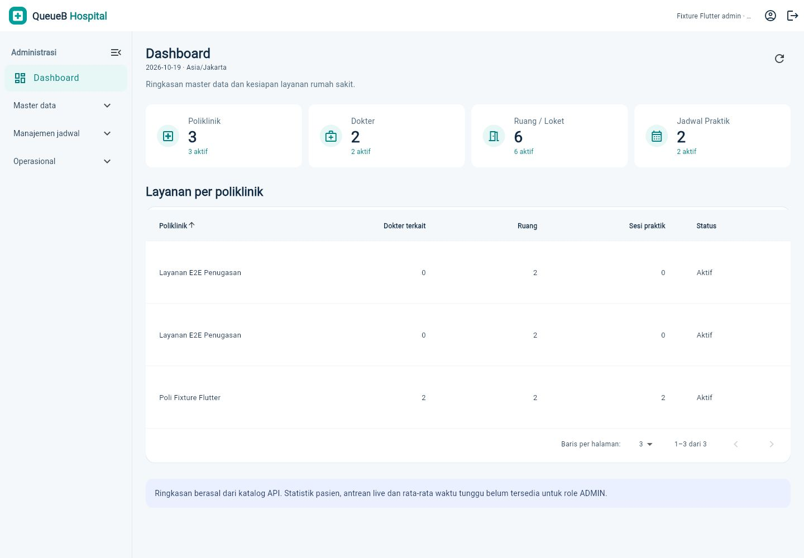
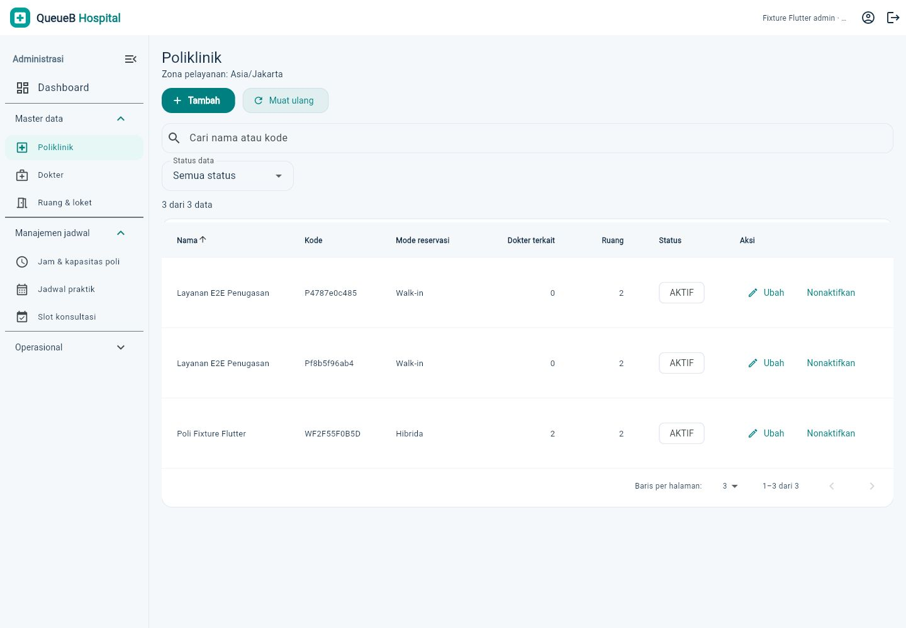
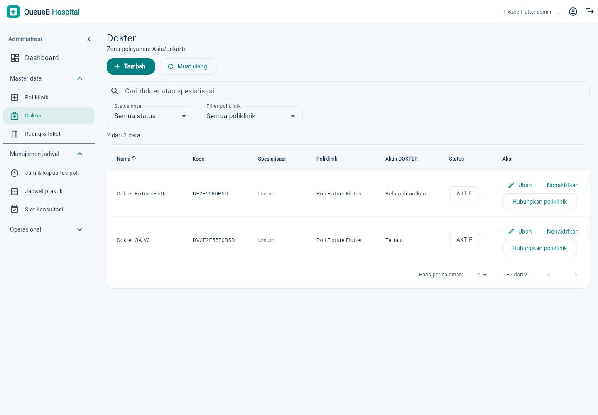
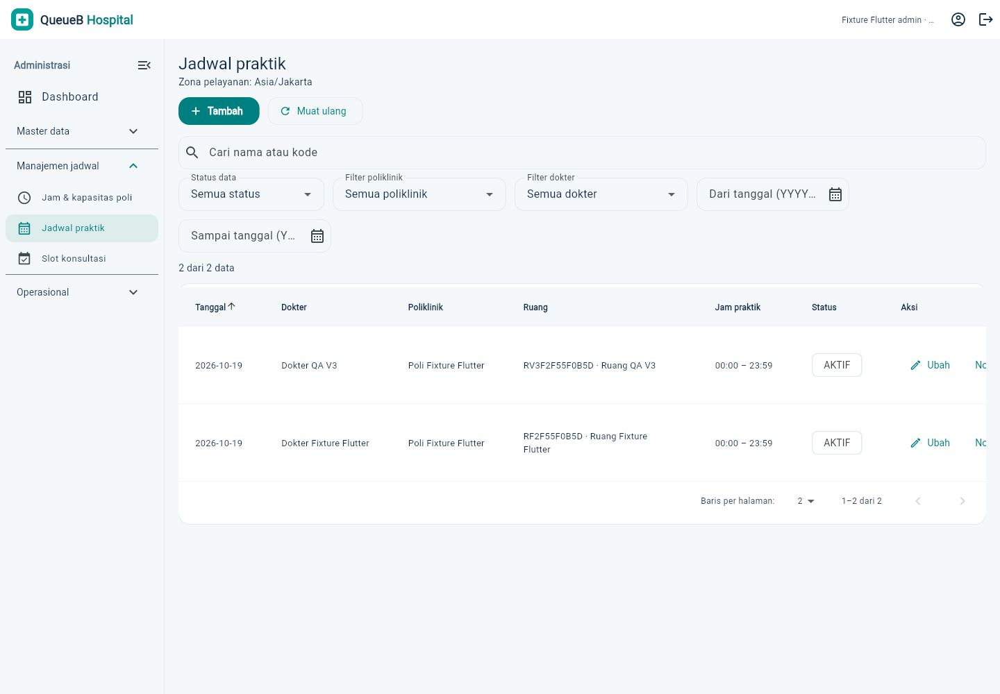
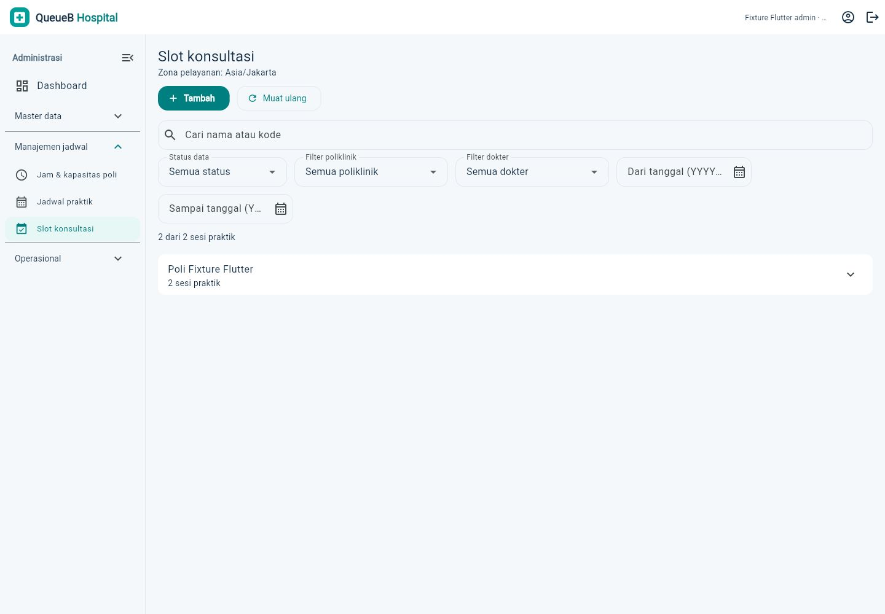
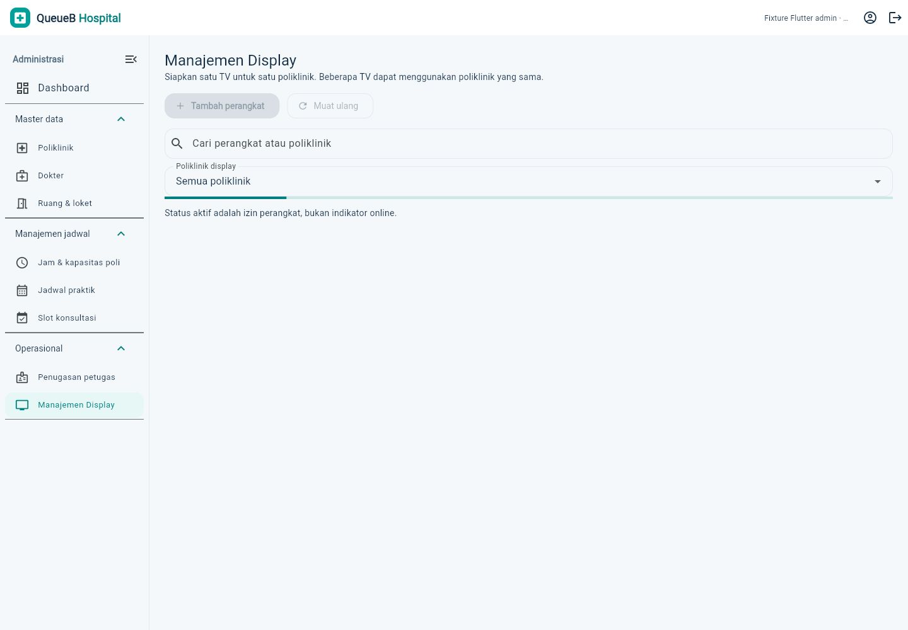
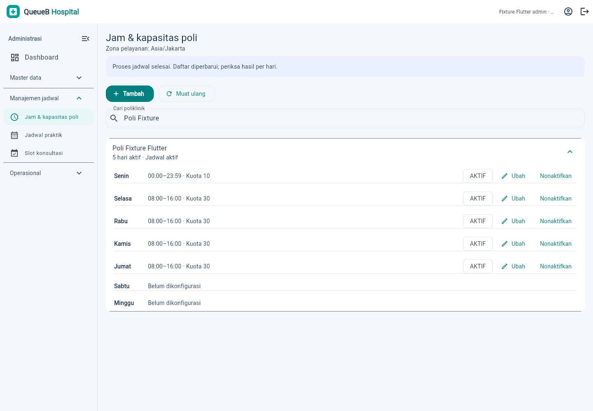

# Dashboard ADMIN V3

Redesign pada aplikasi Flutter existing (`apps/client`). Seluruh operasi memakai kontrak `docs/backend/API_INTEGRATION_GUIDE.md`; backend, database, autentikasi, realtime, dan tampilan role lain tidak diubah.

## Modul

| Modul | Perilaku |
| --- | --- |
| Dashboard | Jumlah master poliklinik, dokter, ruang/loket dan sesi praktik dari katalog REST; ringkasan keterkaitan per poliklinik. Data yang gagal dimuat diberi keterangan, tanpa statistik pasien atau estimasi buatan. |
| Navigasi | Sidebar desktop dapat diciutkan, kategori dapat dibuka/tutup, menu adaptif pada layar sempit. Profil dan logout tetap tersedia. |
| Poliklinik | Tabel nama, kode, mode reservasi, dokter/ruang terkait, status; pencarian, filter, tambah/ubah/nonaktifkan. |
| Dokter | Tabel spesialisasi, poliklinik, status akun; CRUD, hubungan poliklinik dan provisioning akun DOKTER existing. |
| Ruang/loket | Dikelompokkan per poliklinik; kode, lokasi, status dan aksi. |
| Jam & kapasitas poli | Tujuh hari dalam satu kelompok compact; bulk input dan penanganan hasil parsial existing tetap berlaku. |
| Jadwal praktik | Tabel tanggal, dokter, poliklinik, ruang, jam, status; filter dokter/poli/status/rentang tanggal. Modal kalender dan pemilih jam existing dipertahankan. |
| Slot konsultasi | Poli → dokter → sesi praktik; slot baru dimuat saat sesi dibuka, tabel kapasitas/terisi/sisa/ketersediaan dan aksi. |
| Penugasan petugas | Tabel akun, ruang dan periode; validasi backend existing tetap menentukan konflik. |
| Manajemen Display | Tabel per poliklinik, akses aktif/dicabut, aktivitas terakhir; tambah, kode aktivasi/rotasi, reaktivasi dan nonaktifkan existing. Akses aktif tidak ditafsirkan sebagai perangkat online. |

Tabel menggunakan sorting dan pagination lokal 10/20/50 baris karena endpoint existing mengembalikan array. Hanya halaman aktif membangun widget baris. Tabel dapat digeser horizontal pada layar sempit. Tidak ada asumsi server-side pagination atau endpoint analitik baru.

Form menggunakan kalender/pemilih waktu, validasi inline, status penyimpanan dan error API. Daftar pilihan panjang dapat dicari. API belum menyediakan direktori akun PETUGAS: akun yang sudah ditugaskan bisa dipilih; penugasan pertama menggunakan **Tempel ID dari profil petugas**, tanpa mengetik UUID. Tidak ada pembuatan akun PETUGAS baru dari UI.

## Pemeriksaan

- `dart format`: selesai; `flutter analyze`: tanpa issue.
- `flutter test`: **196 lulus, 1 dilewati** (integrasi API nyata memerlukan fixture khusus).
- Regresi mencakup viewport 320/375/414/768/1440, formulir jadwal, bulk input, dataset 2.000 baris, sorting numerik, pagination/filter, autentikasi/sesi, pasien, petugas, DOKTER dan Public Display.
- Web release JavaScript dan APK debug source final: **berhasil**. Preflight Wasm masih memperingatkan interop pada dependency `flutter_tts` dan `socket_io_common` existing. Gradle memperingatkan migrasi plugin ke Built-in Kotlin; APK tetap berhasil dibangun.
- Regresi integrasi API nyata: **1 lulus**, mencakup appointment/walk-in → QR → antrean → pelayanan, dan Socket.IO.
- QA browser/API ADMIN: tambah/ubah/nonaktifkan poli; tambah dokter dan pengaitan poli; provisioning/login/profil DOKTER; tambah ruang dan praktik; tambah/ubah slot; ubah penugasan; bulk input **4 berhasil, 1 existing dilewati, 0 gagal**; tambah perangkat, kode aktivasi/rotasi, nonaktifkan perangkat.
- QA akhir hanya memakai `127.0.0.1:5433/capstone_antrean_test`. Setelah cleanup fixture unik: **13 record existing identik, 0 hilang/berubah, 0 fixture tersisa**. Ke-42 file lokal yang dilindungi tetap identik.
- Catatan lingkungan QA: IAB mengalami timeout intermiten pada GET ulang dengan revalidasi HTTP. Pemeriksaan browser akhir memakai transport harness lokal yang memaksa respons baru (`If-None-Match` noncocok). Ini hanya diagnostik di file ignored, bukan perubahan source/kontrak aplikasi. Endpoint REST langsung dan regresi Flutter tetap diuji dengan transport normal. Pemeriksaan browser reguler saat deployment tetap dianjurkan.

## Screenshot

Data pada screenshot adalah fixture database tes, bukan statistik rumah sakit sebenarnya. Tidak ada token atau kode aktivasi dalam gambar.

| Dashboard | Poliklinik |
| --- | --- |
|  |  |

| Dokter | Jadwal praktik |
| --- | --- |
|  |  |

| Slot konsultasi | Manajemen Display |
| --- | --- |
|  |  |

## Batas kontrak

- Angka dashboard adalah jumlah master dan sesi pada respons katalog, bukan kunjungan pasien atau khusus hari ini.
- Ketersediaan slot mengikuti respons backend; UI tidak menghitung peluang booking atau nomor antrean.
- Waktu mengikuti `SERVICE_TIME_ZONE` (default `Asia/Jakarta`).
- Tidak ada perubahan schema, migration atau endpoint.
- Dataset tetap diunduh sebagai array. Pagination lokal mengurangi widget yang dirender, bukan volume respons jaringan.
