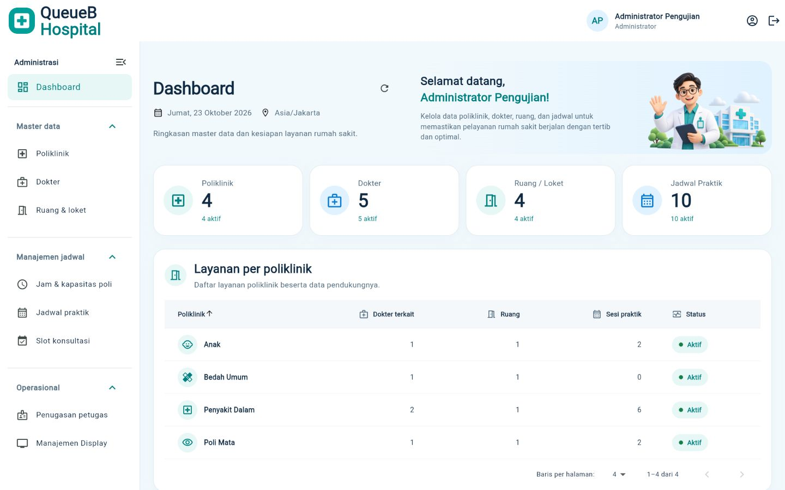
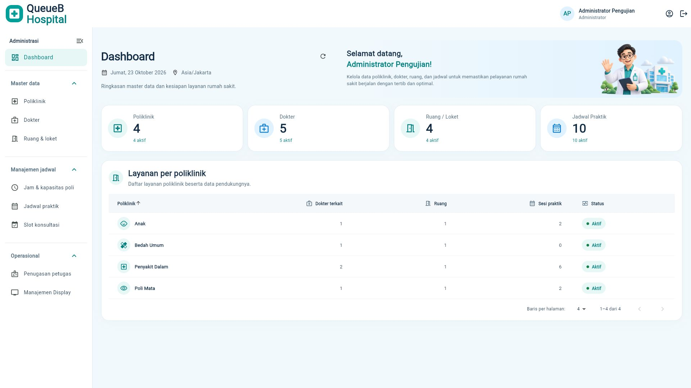

# Dashboard ADMIN — penyelarasan visual QueueB Hospital

Referensi utama: `Modern Hospital Admin Dashboard.png` dari Project Lead. Implementasi dilakukan pada Flutter existing `apps/client`, dengan baseline main `9b45b31` (PR #53).

## Perubahan

- Sidebar putih dengan kelompok Administrasi, Master data, Manajemen jadwal, dan Operasional. Semua delapan menu existing dipertahankan. Grup terbuka saat masuk dashboard, tetap dapat ditutup, dan sidebar desktop dapat diciutkan.
- Header khusus ADMIN memakai branding QueueB, nama sesi, avatar inisial, role, serta tombol profil/logout existing. Tidak ditambahkan pencarian global atau notifikasi dekoratif.
- Sapaan memakai nama dari sesi dengan fallback `Administrator`. Ilustrasi lokal `assets/illustrations/admin_welcome.png` bersifat dekoratif dan terpisah dari teks. Asset dibuat khusus untuk banner, bukan screenshot mockup.
- Empat kartu master data berwarna putih dengan ikon teal/biru, angka katalog aktual, dan jumlah aktif. Tombol kartu membuka modul terkait. Loading memakai progress existing; katalog yang belum tersedia ditampilkan dengan `—`, dan error tetap ditampilkan melalui notice existing.
- Panel tabel poliklinik memiliki baris 52–60 px, ikon kategori, badge status, dan hover lembut. Sorting dan pagination existing dipertahankan. Ukuran ringkas hanya diaktifkan pada tabel dashboard.
- Tanggal mengikuti `SERVICE_TIME_ZONE` existing dan ditampilkan dalam Bahasa Indonesia.

## Kontrak dan batas perubahan

Sumber data tetap `QueueApi` dan katalog existing: `GET /layanan`, `/dokter`, `/loket`, `/jadwal-praktik`. Penghitungan dokter terkait, ruang, dan sesi per poliklinik mengikuti relasi yang sudah digunakan sebelumnya. Tidak ada endpoint, schema, migration, atau perilaku antrean baru.

Tidak ada angka KPI yang disalin dari mockup, statistik pasien, persentase, atau grafik tambahan. Tidak ada perubahan login PR #53, autentikasi/RBAC, Socket.IO, halaman PETUGAS, DOKTER, PASIEN, maupun Public Display.

## Responsivitas

| Area | Desktop | Tablet/mobile |
| --- | --- | --- |
| Sidebar | 256 px, dapat diciutkan menjadi 80 px | Drawer administrasi existing di bawah 960 px |
| Banner | Berdampingan dengan judul pada konten ≥900 px | Ditumpuk, deskripsi ringkas pada banner <440 px |
| KPI | 4 kolom pada konten ≥900 px | 2 kolom mulai 520 px, 1 kolom di bawahnya |
| Tabel | Lima kolom dengan pagination | Scroll horizontal dalam tabel; halaman tetap dapat digulir vertikal |

## Verifikasi

- `dart format --output=none --set-exit-if-changed lib test`: PASS, 54 file tanpa perubahan format.
- `flutter analyze --no-pub`: PASS, tidak ada temuan.
- `flutter test --no-pub --reporter expanded`: PASS, 234 lulus dan 1 tes live integration dilewati sesuai gate existing.
- `flutter build web --no-pub --dart-define=API_BASE_URL=http://localhost:3000/api/v1 --dart-define=SERVICE_TIME_ZONE=Asia/Jakarta`: PASS, output `apps/client/build/web`.
- Sembilan tes baru mencakup lima ukuran viewport, KPI dari data berbeda/nonaktif, fallback nama sesi, refresh/navigasi, grup sidebar, hover tabel tanpa seleksi, dan avatar inisial. Regresi existing mencakup seluruh modul ADMIN, penyimpanan jadwal praktik, autentikasi/sesi, PETUGAS, tiket/booking pasien, DOKTER, serta Public Display.
- `git diff --check` dan pemeriksaan staging: PASS; hanya 18 file yang terkait pekerjaan ini.

Preview browser memakai HTTP fixture sintetis melalui entry QA yang diabaikan Git. Preview tidak terhubung ke database development, dan tidak memuat pasien atau kredensial nyata. Nilai 4/5/4/10 pada screenshot berasal dari fixture visual; tes regresi memakai jumlah berbeda dan data nonaktif untuk memastikan KPI bukan hardcode. Tidak dilakukan klaim pengujian ulang backend live pada pekerjaan visual ini.

Pemeriksaan browser: login fixture → dashboard, refresh, ciutkan/perluas sidebar, profil akun, drawer mobile → Poliklinik → Dashboard, akses keyboard kolom tabel, dan logout → login. Semua menu existing tetap tersedia. Resolusi yang diperiksa: 1366×768, 1440×900, 1920×1080, 768×1024, dan 375×900.

## Screenshot QA

Desktop 1440×900:

Desktop 1920×1080:

[Laptop 1366×768](images/admin-refresh/laptop-1366.jpg) · [Tablet 768×1024](images/admin-refresh/tablet-768.jpg) · [Mobile 375×900](images/admin-refresh/mobile-375.jpg) · [Tabel mobile](images/admin-refresh/mobile-table-375.jpg)

## Catatan

- Satu tes live integration existing memerlukan runner dan database test tervalidasi; tidak dijalankan sebagai bagian tes widget biasa.
- Build Web JavaScript menggunakan dependency existing. Peringatan dry-run Wasm dari dependency TTS/Socket.IO tetap menjadi batas dukungan Wasm; pekerjaan ini tidak mengubah dependency atau menargetkan build Wasm.
- Sebanyak 42 file lokal pengguna diperiksa berdasarkan hash baseline dan dipertahankan. File lokal tersebut, backup, konfigurasi rahasia, entry QA, serta artefak build tidak dimasukkan dalam commit.
