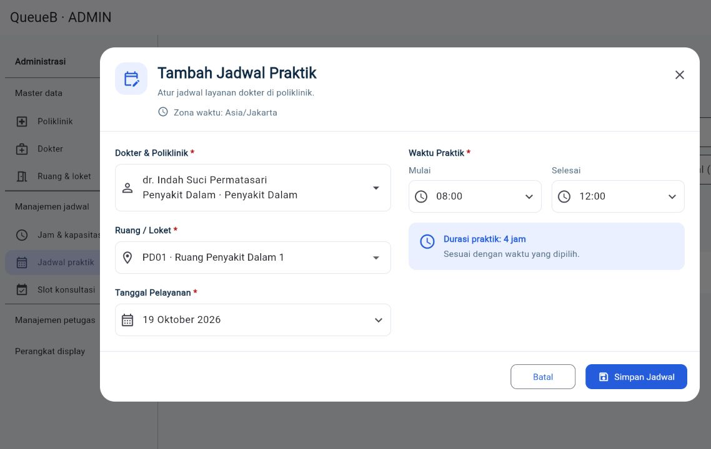
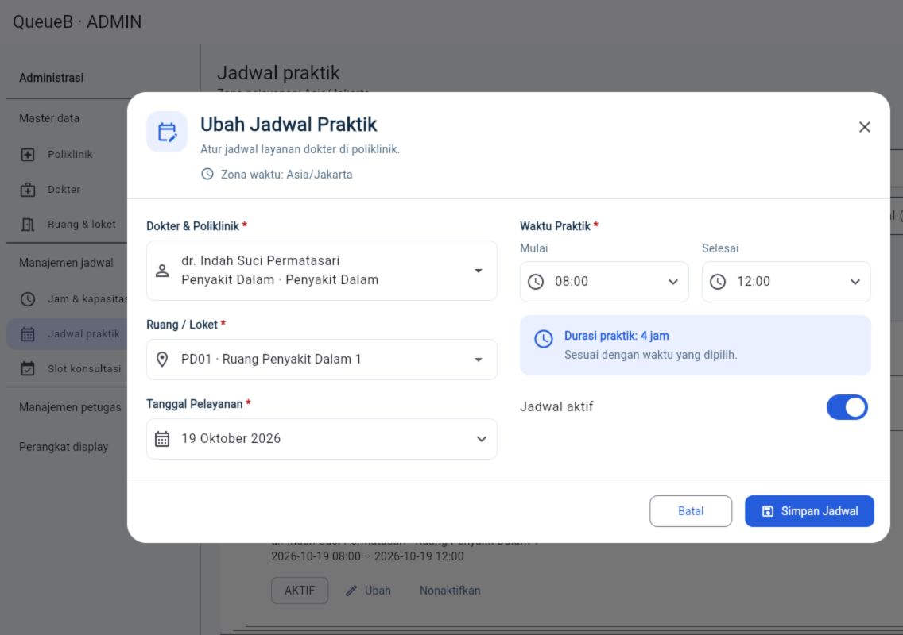

# Form Jadwal Praktik ADMIN

Perubahan terbatas pada modal **Tambah Jadwal Praktik** dan **Ubah Jadwal Praktik** di Flutter existing. Kedua aksi memakai `PracticeScheduleEditor`; modul lain tetap memakai editor sebelumnya.

## Interaksi

- Dokter & Poliklinik dapat dicari berdasarkan nama, spesialisasi, atau nama poliklinik. Teks pencarian yang belum dipilih dari daftar tidak dapat disimpan sebagai pilihan dokter.
- Ruang/loket mengikuti poliklinik dokter. Ruang yang tidak sesuai dibersihkan ketika pilihan poliklinik berubah. Pilihan existing tetap dapat ditampilkan saat mengubah data lama.
- Tanggal dipilih dari kalender; jam memakai time picker 24 jam. Durasi dihitung dari pilihan mulai dan selesai pada tanggal yang sama.
- Desktop menampilkan dua kolom. Tablet dan mobile memakai susunan satu kolom dengan isi yang dapat di-scroll serta tombol aksi tetap terjangkau.
- Form menahan submit ganda dan penutupan selama request. Setelah sukses, modal ditutup dan katalog/daftar ADMIN diambil ulang. Error mempertahankan isian agar dapat dikoreksi.

## Kontrak API yang dipertahankan

Rujukan: [API Integration Guide](../backend/API_INTEGRATION_GUIDE.md), bagian Hospital.

`POST /jadwal-praktik` tetap mengirim tepat lima field: `dokterLayananId`, `loketId`, `tanggal`, `mulaiPada`, dan `selesaiPada`. Kalender menghasilkan `tanggal` dalam `YYYY-MM-DD`; gabungan tanggal dan jam dikonversi oleh `AppConfig.toInstant` dari `SERVICE_TIME_ZONE` ke ISO UTC. Pada konfigurasi Asia/Jakarta, 08:00 menghasilkan 01:00Z.

`PATCH /jadwal-praktik/:id` mengirim perubahan saja. Perubahan tanggal menggeser kedua timestamp ke tanggal pelayanan yang dipilih. Timestamp existing tidak dibulatkan atau dikirim ulang ketika tidak berubah; kontrol `aktif` tetap tersedia saat edit. Membuka lalu membatalkan form tidak mengirim mutasi, dan menyimpan form yang tidak berubah menampilkan penjelasan tanpa request.

Tidak ada field catatan dalam DTO existing, sehingga form tidak menampilkan, menyimpan, atau mengirim catatan. Tidak ada endpoint, aturan jadwal berulang, schema, migration, atau perubahan backend baru.

Validasi frontend hanya menangani pilihan wajib, kesesuaian ruang, serta jam selesai setelah jam mulai. Jam operasional, tanggal yang diizinkan, benturan dokter/ruang, dan penguncian jadwal yang memiliki slot tetap diputuskan backend. Pesan penolakan API ditampilkan di modal; pengiriman parsial tidak melewati pembatasan tersebut.

## Verifikasi

Widget test memakai HTTP mock untuk memeriksa payload POST/PATCH, pemilihan kalender/jam, konversi zona waktu, pencarian dokter, filter/reset ruang, prefill, pembatalan, validasi, konflik API, penguncian slot, loading, dan refresh daftar. Ukuran yang diuji: 320, 375, 414, 768, 1280, dan 1920 logical pixel.

Hasil verifikasi 19 Oktober 2026:

- `flutter analyze`: tidak ada masalah.
- `flutter test`: 173 PASS, 1 SKIP (live integration existing yang memerlukan konfigurasi khusus); 26 kasus khusus form ini termasuk dalam total tersebut.
- `dart format --output=none --set-exit-if-changed .`: 45 file diperiksa, tidak ada perubahan format tambahan.
- Flutter Web JavaScript release: PASS. Dry run WebAssembly masih melaporkan kompatibilitas dependency `flutter_tts`/`socket_io_common` existing; dependency dan target WebAssembly tidak diubah.
- Browser fixture: tambah dengan tanggal kalender dan jam 08:00–12:00, pembaruan daftar setelah submit, edit jam selesai ke 13:30, prefill, durasi otomatis, dan layout mobile 375×812 terverifikasi.

Screenshot di bawah diambil dari komponen aplikasi yang dibangun untuk browser QA dengan HTTP fixture dalam memori. Identitas dan jadwal pada screenshot merupakan data fixture; QA visual tidak menulis database development atau mengubah jadwal existing. Keberhasilan submit di widget/browser fixture memverifikasi integrasi frontend dan bentuk request, bukan uji mutasi ke database nyata.

### Tambah Jadwal Praktik



### Ubah Jadwal Praktik



Build aplikasi utama:

```powershell
flutter build web --release --no-pub --output build/web_admin_jadwal --dart-define=API_BASE_URL=http://localhost:3000/api/v1 --dart-define=SERVICE_TIME_ZONE=Asia/Jakarta
```

Output terpisah menjaga build yang sedang dipakai pada server development tetap tersedia. Target verifikasi adalah Flutter Web JavaScript release; dukungan WebAssembly tidak diubah dalam pekerjaan ini.
