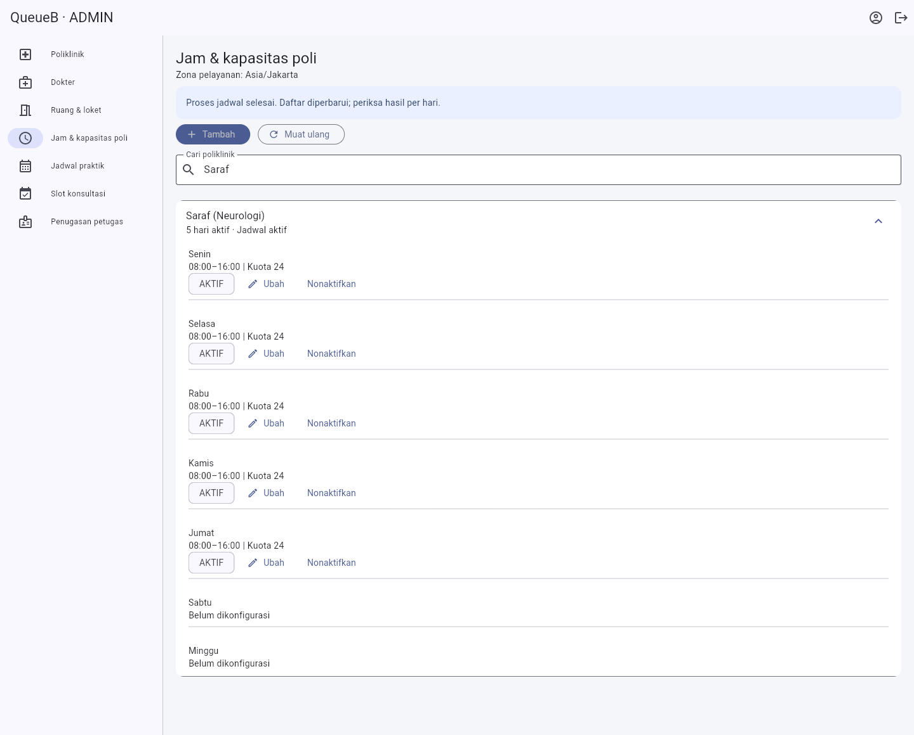
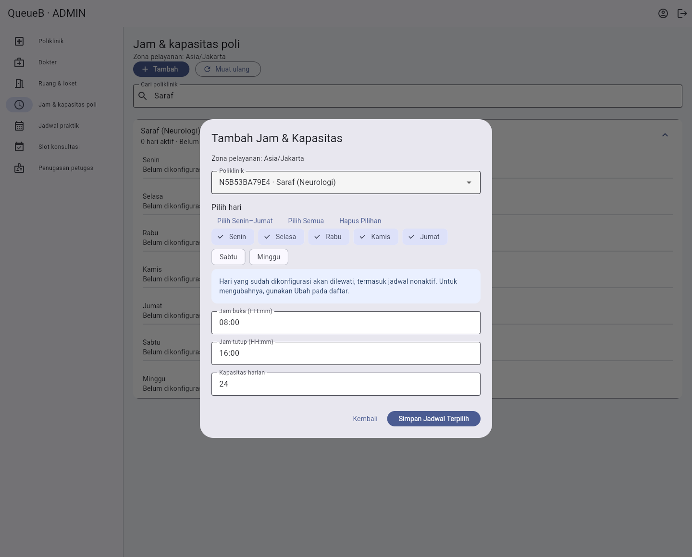

# Perbaikan ADMIN — Poliklinik serta Jam & Kapasitas Poli

Scope: Flutter existing `apps/client`, dua menu ADMIN. Tema, navigasi utama, USER, PETUGAS, Public Display, konfigurasi API Android, endpoint dan source backend tetap.

## Akar masalah tambah poliklinik

Diagnosis pada 17 Oktober 2026 menemukan database development **`127.0.0.1:5433/capstone_antrean`** baru memiliki tiga migration sampai `20261013_hospital_h1_fondasi`. Enum PostgreSQL `mode_reservasi` hanya berisi `ANTREAN_HARIAN` dan `JANJI_TEMU_DOKTER`, sedangkan form Flutter mengirim `modeReservasi: HIBRIDA` secara default. Prisma schema/client dan kontrak API sudah mengenal ketiga mode.

`NEURO` belum terpakai pada database tersebut. Payload Flutter menggunakan integer `durasiDasarMenit: 25`, dan DTO menerima 1–240. Nama `Saraf (Neurologi)` serta prefix `SF` valid. Tidak ditemukan CHECK constraint pembatas durasi 25 pada tabel layanan.

Pembuktian tanpa menulis fixture development: `SELECT 'HIBRIDA'::mode_reservasi` dalam transaksi **READ ONLY** menghasilkan PostgreSQL **22P02**, `invalid input value for enum mode_reservasi: "HIBRIDA"`. Probe Prisma raw read-only menghasilkan `PrismaClientKnownRequestError P2010` dengan cause adapter `22P02`. Handler layanan existing menangani keunikan/not-found, sehingga ketidaksesuaian enum database menyebabkan error server. Log historis terminal NestJS tidak tersedia karena terminal lama tidak terpasang pada chat ini; diagnosis tidak mengklaim rekaman POST historis.

Setelah persetujuan eksplisit Project Lead, target dan daftar pending diverifikasi lagi. Hanya migration existing **`20261014_hospital_h3_hibrida`** yang pending, dengan SQL aditif `ALTER TYPE ... ADD VALUE IF NOT EXISTS 'HIBRIDA'`. `prisma migrate deploy` berhasil menerapkannya. Tidak ada migration/schema baru, reset, SQL perbaikan spekulatif atau perubahan source backend.

Fingerprint seluruh tabel data sebelum/sesudah migration memastikan **171 record development tetap identik**. Enum kini memuat HIBRIDA dan empat migration selesai. Port server PostgreSQL di dalam container adalah 5432; endpoint host yang diverifikasi dan digunakan tetap **127.0.0.1:5433**.

Form mempertahankan pesan validasi 400 dan konflik 409 dari API. Untuk kegagalan server 5xx, form Poliklinik memberi arahan memeriksa log API/migration dan membaca daftar sebelum mencoba ulang, tanpa membocorkan detail database. Tombol simpan/kembali terkunci selama request; tidak ada retry mutasi otomatis. Keunikan kode tetap diputuskan backend.

Untuk environment lain: periksa target DATABASE_URL dan `prisma migrate status` dahulu. Migration development yang dilakukan di sini bukan instruksi untuk menjalankan migration pada database lain tanpa persetujuan pemiliknya.

## Pengelolaan jadwal

- Satu kartu expandable per poliklinik, menggunakan nama asli API. Seluruh hari ditampilkan SENIN–MINGGU, termasuk indikator **Belum dikonfigurasi**. Jadwal nonaktif tetap terlihat dan dapat diedit.
- Ringkasan menunjukkan jumlah hari aktif dan status konfigurasi (bukan klaim poli sedang buka saat ini). Poliklinik nonaktif ditandai terpisah.
- Pencarian berdasarkan nama atau kode. Poliklinik tanpa jadwal juga ditampilkan. Tombol Ubah dan Nonaktifkan tetap menggunakan endpoint existing; DELETE adalah soft-deactivate.
- Area semantik pencarian dipisahkan dari kartu agar klik Web tidak terhalang. Pesan form ADMIN dan ringkasan bulk memakai label live yang dapat dibaca screen reader; tampilan Notice existing dipertahankan.
- Tambah membuka form satu poliklinik, multiselect hari, preset Senin–Jumat/semua/hapus, jam dan kapasitas sekali isi.
- Validasi minimal satu hari, HH:mm 24 jam, jam tutup sesudah jam buka, kapasitas bilangan bulat positif. Tidak ada perubahan kebijakan jam lintas tengah malam.
- GET `/jadwal-layanan` terbaru dilakukan sebelum POST. Kombinasi poli/hari existing **termasuk nonaktif** dilewati dan diarahkan ke Ubah; tidak ada PATCH/overwrite dalam proses bulk.
- POST satu per hari secara **sequential**. Hasil berhasil/dilewati/gagal atau belum terverifikasi dicatat per hari. Tidak ada endpoint bulk baru dan tidak ada transaksi atomik lintas hari.
- Kegagalan POST diperiksa ulang melalui GET karena respons bisa hilang setelah commit. Record yang ditemukan diarahkan ke Ubah; hasil yang belum dapat dibuktikan dinyatakan demikian. POST tidak diulang otomatis. Setelah hasil keluar tombol simpan tidak tersedia lagi; tutup memuat ulang daftar (termasuk bila dialog ditutup melalui tombol back). Percobaan baru selalu melakukan preflight lagi, sehingga hari sukses tidak dikirim ulang. Constraint unik backend melindungi persaingan ADMIN.

## Pengujian yang dapat diulang

Gunakan Flutter dan dependency tooling yang sudah terpasang. Dari `apps/client`:

```powershell
dart format --output=none --set-exit-if-changed .
flutter analyze
flutter test
flutter build web --release --no-web-resources-cdn --no-wasm-dry-run --dart-define=API_BASE_URL=http://127.0.0.1:3001/api/v1
npm --prefix ../api run build
```

Dari root repository:

```powershell
node apps/client/tool/run-live.cjs --admin-schedules
```

Harness hanya memakai **`127.0.0.1:5433/capstone_antrean_test`**, memvalidasi `current_database()` sebelum fixture dan mengoverride provider Prisma dengan URL test eksplisit. Tidak melakukan migration/reset. Seluruh data existing dibandingkan melalui fingerprint sebelum/sesudah; cleanup hanya ID/kode unik milik run tersebut. Kode poli fixture dibuat unik agar tidak menyentuh `NEURO` yang mungkin sudah dimiliki pengguna lain. Nama/prefix/durasi/mode memakai contoh yang dilaporkan.

Browser Edge menjalankan build Flutter Web, login JWT ADMIN nyata, POST/GET/PATCH/DELETE menuju NestJS nyata. Satu respons 503 disuntikkan pada batas jaringan browser untuk menguji kegagalan parsial; request lain dan rekonsiliasi tetap menggunakan API nyata. Ini simulasi gangguan terkontrol, bukan klaim terjadi kegagalan PostgreSQL spontan.

## Hasil QA

Verifikasi pada 17 Oktober 2026:

| Pemeriksaan | Hasil aktual |
| --- | --- |
| Flutter unit/widget | **60 PASS**, termasuk 12 regresi baru; satu tes live umum SKIP secara default |
| Analyzer | **PASS**, tanpa temuan |
| Format Dart | **PASS** |
| Web release JS/CanvasKit | **PASS** pada konfigurasi API test 3001 dan artefak development 3000 |
| Android APK debug | **PASS**, `build/app/outputs/flutter-apk/app-debug.apk`; API USB 127.0.0.1:3000 |
| NestJS build existing | **PASS**; source backend tidak diubah |
| Browser ADMIN | Seluruh skenario di bawah **PASS** pada build final; **0 runtime error** |

Skenario browser nyata:

1. Tambah poli dengan nama `Saraf (Neurologi)`, prefix `SF`, durasi integer **25**, mode **HIBRIDA**: HTTP **201** dan nilai tersimpan sesuai request. Kode fixture unik menggantikan `NEURO` untuk isolasi.
2. Kode duplikat: HTTP **409**, pesan **Kode layanan sudah digunakan** tersedia di UI. Durasi nol ditolak API HTTP **400** dengan alasan validasi.
3. Lima hari Senin–Jumat: **5 berhasil, 0 dilewati, 0 gagal**; hanya lima POST, urutan hari benar, kuota 24 dan jam 08:00–16:00 tersimpan.
4. Simpan hari yang sudah ada: **0 berhasil, 5 dilewati, 0 gagal**, tanpa POST tambahan. Jadwal nonaktif juga tetap dilewati.
5. Pilih semua, simulasi 503 pada Sabtu: **1 berhasil, 5 dilewati, 1 belum terverifikasi**. Pemeriksaan ulang GET dilakukan, proses Minggu tetap selesai. Percobaan baru hanya mengirim Sabtu: **1 berhasil, 6 dilewati**. Total delapan percobaan POST untuk tujuh hari, termasuk satu gangguan yang disuntikkan; tidak ada retry otomatis atau duplikasi record.
6. Ubah Senin menjadi tutup **17:00**, kuota **30**: PATCH **200** dan ID tetap.
7. Nonaktifkan Senin: DELETE **200**, `aktif:false`; seluruh **7 record** tetap ada, tidak ada penghapusan. Bulk berikutnya melewati Senin yang nonaktif.
8. Muat ulang serta reload halaman/login ulang: hasil konsisten, **6 hari aktif** dan tujuh konfigurasi tetap tersimpan.

Fingerprint database test setelah setiap run: **13 record existing, 0 hilang, 0 berubah; 0 fixture baru tersisa**. Tidak ada fixture ditulis ke database development. Masalah semantik pesan dan area pencarian Web yang ditemukan selama integrasi telah diperbaiki dan tercakup pada hasil final di atas.

Screenshot browser final (1440 × 1160), menggunakan fixture test yang telah dibersihkan:





## Build dan batas verifikasi

APK debug berhasil dibangun setelah QA browser. Konfigurasi API tetap diberikan melalui dart-define; tidak ada perubahan `config.dart`, manifest, koneksi ADB atau entrypoint aplikasi. Build Web development memakai `http://localhost:3000/api/v1`; APK USB memakai `http://127.0.0.1:3000/api/v1`, sesuai build fisik sebelumnya. Untuk emulator/LAN, gunakan alamat existing sesuai README.

Build bukan klaim pengujian fisik Android pada perubahan ini. Fokus integrasi langsung adalah dashboard ADMIN Web. Warning dependency existing (`flutter_tts`/Kotlin Gradle dan deprecation antrean query pg sebelum pg@9) tidak diperluas menjadi upgrade dependency pada scope ini. Bulk bukan operasi atomik; hasil parsial dan rekonsiliasi harus tetap diperhatikan pengguna.

## File implementasi

- `apps/client/lib/src/admin.dart`: wiring menu/dialog, refresh, validasi edit, konfirmasi hari, pesan kegagalan server Poliklinik.
- `apps/client/lib/src/admin_schedules.dart`: grouping, pencarian, form multihari, preflight, request terkontrol dan hasil per hari.
- `apps/client/test/admin_schedules_test.dart`: regresi grouping/bulk, validasi, duplikasi, respons hilang, klik ganda dan payload Poliklinik.
- `apps/client/tool/browser-admin-schedules.cjs`: QA ADMIN pada browser dan API nyata.
- `apps/client/tool/run-live.cjs`, `browser-smoke.cjs`: opsi `--admin-schedules`, cleanup fixture unik tambahan dan dispatch QA.
- README Flutter dan dokumen ini: panduan verifikasi/diagnosis; screenshot adalah artefak test, bukan data pasien.

Kontrak integrasi tetap [API_INTEGRATION_GUIDE.md](../backend/API_INTEGRATION_GUIDE.md), khususnya bagian 13 dan 17. Tidak ada fitur rumah sakit tambahan.
