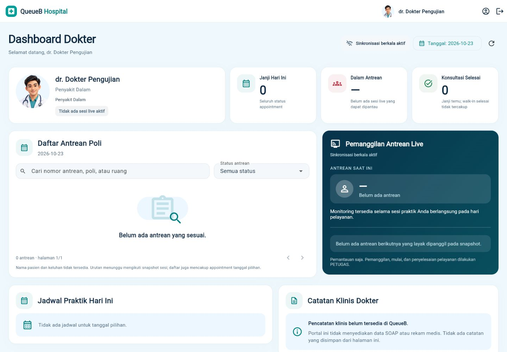
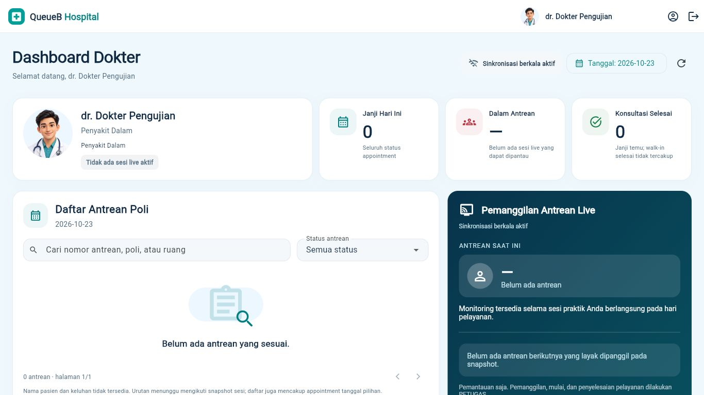

# Dashboard Dokter — penyelarasan visual QueueB Hospital

Referensi: `QueueB Hospital Doctor Dashboard.png` dan instruksi Project Lead. Fondasi Doctor Portal satu halaman dari PR #52 dipertahankan. Branch dibuat dari `origin/main` pada `9b45b31` (PR #53); PR #54 terverifikasi tertutup tanpa merge. PR #55 ADMIN masih terpisah dan tidak dibawa ke branch ini.

## Implementasi

Urutan halaman tetap: header → judul dan kontrol → profil dan tiga KPI → antrean dan monitoring live → jadwal dan informasi catatan klinis. Tidak ada sidebar, halaman baru, SOAP, atau aksi operasional untuk dokter.

- Header DOKTER putih setinggi 64 px, avatar generik lokal, nama sesi pada layar lebar, tombol profil dan logout existing.
- Profil menjadi kartu utama dengan avatar, nama/spesialisasi/poliklinik dari profil existing, serta status sesi live aktual.
- Janji Hari Ini, Dalam Antrean, dan Konsultasi Selesai tetap menggunakan `DoctorDashboardData` existing. Tanpa snapshot sesi live, Dalam Antrean tetap `—`. Jumlah selesai hanya mencakup appointment, bukan walk-in selesai; keterangannya dipertahankan.
- Tabel antrean mempertahankan urutan snapshot, pagination 10 baris, pencarian nomor/poliklinik/ruang, filter status, dan dialog detail. Nama pasien/keluhan tidak ditambahkan. Empty state memakai ilustrasi clipboard dari ikon Flutter.
- Panel live memakai gradient navy–teal, nomor aktif, informasi ruang/slot, antrean berikutnya yang layak menurut snapshot, dan keterangan kewenangan PETUGAS. Pemilihan beberapa antrean aktif dan detail existing tetap berfungsi.
- Jadwal dan catatan klinis memakai judul berikon serta info card biru muda. Tidak ada input atau penyimpanan klinis baru.

## File dan komponen

| File | Perubahan |
| --- | --- |
| `apps/client/lib/src/doctor_dashboard.dart` | Presentasi header/kartu/filter/empty state/panel live; `DoctorPanel` existing digunakan kembali |
| `apps/client/lib/src/doctor_visual.dart` | Token/theme DOKTER; `DoctorAvatar`, `DoctorHeaderIdentity`, `DoctorSectionTitle`, `DoctorIconTile`, `DoctorQueueEmpty`, `DoctorInfoBlock` |
| `apps/client/lib/src/app.dart` | Theme dan header bersyarat khusus role DOKTER; callback profil/logout existing |
| `apps/client/assets/illustrations/doctor_avatar.png` | Avatar fiktif generik, dibuat khusus melalui image generation; tidak merepresentasikan dokter nyata |
| `apps/client/pubspec.yaml` | Registrasi asset avatar |
| `apps/client/test/doctor_portal_test.dart` | Simulasi viewport konsisten, ekspektasi nama di header/profil, akses panel setelah perubahan susunan, serta pemeriksaan putus–pulih realtime |
| `apps/client/test/doctor_visual_refresh_test.dart` | Sembilan tes komposisi responsif, state, kontrol dan fallback avatar |

Avatar memiliki fallback ikon lokal bila asset gagal dimuat dan label semantics tersendiri. Widget dan warna memakai Flutter existing dengan token yang dibatasi untuk DOKTER.

## Batas integrasi

`doctor.dart`, `patient_sync.dart`, `api.dart`, serta kontrak backend tetap identik dengan main. Endpoint yang dipakai tetap `/portal-dokter/profil`, `/portal-dokter/jadwal`, `/portal-dokter/janji-temu`, dan `/portal-dokter/antrean/snapshot`; event namespace `/doctor` tetap memicu refresh REST melalui mekanisme existing. Token, session lifecycle, reconnect dan RBAC tidak diubah.

Login PR #53, ADMIN, PETUGAS, PASIEN dan Public Display tidak diubah. Tidak ada source backend, database, migration, atau dependency baru.

## Responsivitas dan QA

- Desktop ≥1200 px: profil + tiga KPI sejajar; antrean dan live berdampingan; jadwal dan catatan klinis berdampingan.
- Laptop 1024 px: profil di atas KPI; panel antrean/live bertingkat agar tetap terbaca.
- Tablet: dua kolom KPI sesuai lebar konten, panel bertingkat.
- Mobile: satu kolom, header ringkas, filter selebar kartu, scroll vertikal. Tabel berisi data mempertahankan scroll horizontal internal existing agar kolom/detail tidak hilang.
- Tes widget pada lebar 320, 375, 414, 768, 1024, 1200, 1366 dan 1440 px memeriksa komposisi tanpa exception layout.

Screenshot dan pemeriksaan browser menggunakan HTTP fixture sintetis pada entry lokal yang diabaikan Git, tanpa akses database development. Status browser menunjukkan `Sinkronisasi berkala aktif` karena preview menonaktifkan socket nyata; status terhubung tidak dipalsukan. Realtime diuji melalui socket simulasi dalam regresi, termasuk event, deduplikasi, pause/resume, disconnect → `doctor:ready` → pengambilan snapshot REST.

QA browser mencakup login, halaman kosong/terisi/error, pencarian, filter status, detail antrean, refresh, pergantian tanggal, profil dan logout. Keyboard Tab/Enter dipakai pada filter serta pemilih tanggal. Focus Material existing dipertahankan. Responsivitas browser diperiksa pada 375, 768, 1024, 1366×768 dan 1440 px.

- `dart format --output=none --set-exit-if-changed lib test`: PASS, 55 file tanpa perubahan format.
- `flutter analyze --no-pub`: PASS, tidak ada temuan.
- `flutter test --no-pub --reporter expanded`: PASS, 234 tes lulus dan 1 live integration existing dilewati sesuai gate runner.
- `flutter build web --no-pub --dart-define=API_BASE_URL=http://localhost:3000/api/v1 --dart-define=SERVICE_TIME_ZONE=Asia/Jakarta`: PASS, output `apps/client/build/web`.
- Regresi khusus Doctor Portal, session dan sinkronisasi: 51 tes PASS; sembilan tes visual tambahan PASS. Full suite juga mencakup ADMIN, PETUGAS, PASIEN, login dan Public Display.
- `git diff --check`: PASS.

## Screenshot

Desktop 1440 px:

Laptop 1366×768:

[Mobile 375 px](images/doctor-refresh/mobile-375.jpg) · [Tablet 768 px](images/doctor-refresh/tablet-768.jpg) · [Laptop 1024 px](images/doctor-refresh/laptop-1024.jpg) · [Antrean aktif](images/doctor-refresh/active-1440.jpg) · [Error API](images/doctor-refresh/error-1440.jpg)

## Batas pengujian dan kesiapan review

Tes browser memakai fixture; tidak mengklaim pengujian ulang Socket.IO/backend live atau perangkat Android fisik. Tes live integration existing memerlukan runner dan database test terisolasi. Perubahan ini ditujukan untuk review visual sebelum merge, tanpa auto-merge.

Peringatan dry-run Wasm dependency existing tetap terpisah dari build Web JavaScript. Seluruh 42 file lokal pengguna diverifikasi dengan hash baseline dan tidak dimasukkan ke commit. Artefak build, entry QA, backup dan rahasia tidak di-stage.
