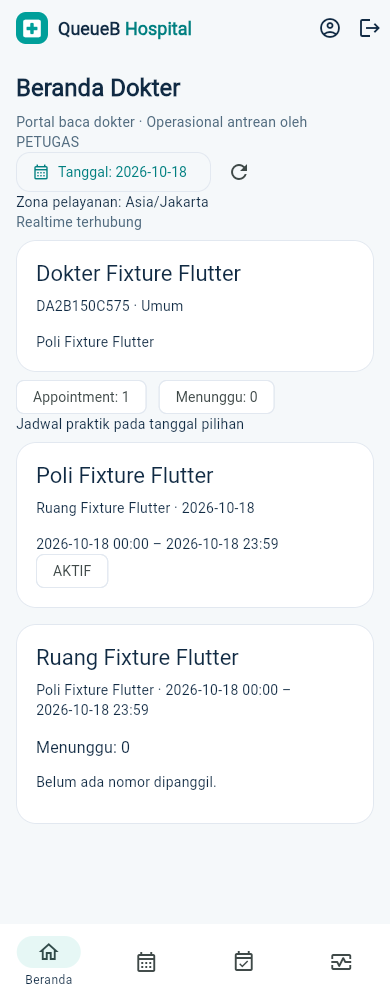
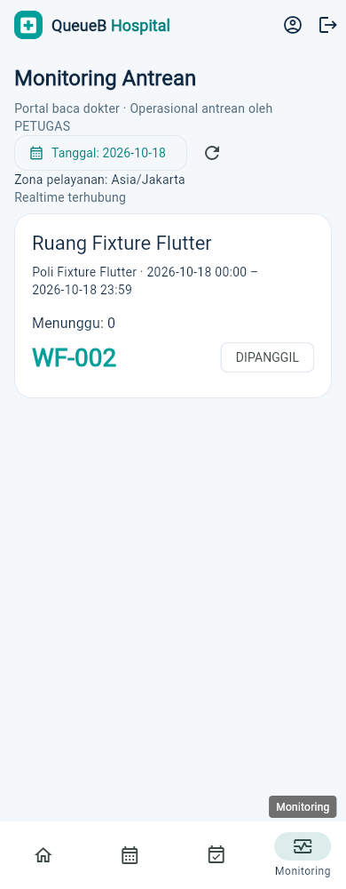
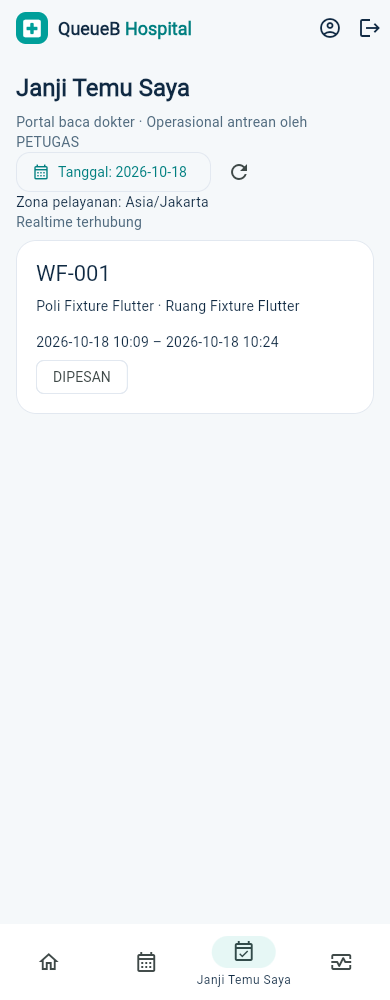

# Doctor Portal QueueB Hospital — D1–D4

Tanggal implementasi/QA: 18 Oktober 2026. Branch `feature/hospital-doctor-portal`, base main setelah PR #45. Backend dan Flutter memakai empat role; seluruh operasi antrean tetap PETUGAS. Tidak ada fitur klinis atau perubahan desain existing.

## Perubahan dan kontrak

- D1: enum DOKTER dan relasi Dokter.penggunaId nullable/unique → Pengguna.id. ADMIN membuat atau menautkan akun melalui POST `/dokter/:id/akun`; akun harus DOKTER aktif. Tidak ada self-link/promosi pasien/reassignment. Pembuatan/penautan atomik; race gagal rollback akun baru. Dokter existing tanpa akun tetap valid.
- D2: GET `/portal-dokter/profil`, `/jadwal`, `/janji-temu`, `/antrean/snapshot`. ID dokter diturunkan dari akun, bukan frontend. Jadwal/appointment memakai filter tanggal, default hari pelayanan. Snapshot menerima jadwalPraktikId dan hanya sesi sendiri aktif hari ini. Appointment dokter lain terisolasi, termasuk jika tiket mengarah ke ruang yang sama. Walk-in HIBRIDA dipantau dengan metadata minimum pada ruang/sesi yang berwenang. Selector Hospital dan status tiket existing digunakan.
- D3: namespace `/doctor` terpisah dari PETUGAS. JWT/sesi/akun/profil dan scope tanggal/ruang/sesi divalidasi. Event setelah commit hanya invalidasi; data dibaca ulang dari REST. Tidak ada QR, identitas pasien, nomor telepon/email pasien, tiketId atau data klinis di portal/broadcast.
- D4: satu aplikasi Flutter existing, route DOKTER tersendiri. Beranda Dokter, Jadwal Saya (kalender), Janji Temu Saya dan Monitoring Antrean semuanya read-only. Login, pemulihan sesi Android, rotasi JWT, logout, reconnect, debounce, dedup, background/resume memakai fondasi existing. Feed pasien diparameterkan dengan default USER yang tetap sama; satu feed per halaman dokter.

ADMIN mendapat aksi **Akun dokter** pada master Dokter. Buat email/kata sandi awal atau tautkan UUID akun DOKTER existing yang belum digunakan. Profil yang telah bertaut hanya menampilkan informasi tautan; tidak menyediakan penggantian akun. Password hanya dikirim saat provisioning, diproses PasswordService existing dan tidak dipersistenkan oleh Flutter.

Kontrak lengkap/body/response/error/RBAC: [API_INTEGRATION_GUIDE.md Bagian 19](../backend/API_INTEGRATION_GUIDE.md#19-doctor-portal--d1d4-18-oktober-2026). Status backend: [MVP_BACKEND_FINAL.md](../backend/MVP_BACKEND_FINAL.md).

## Database dan deployment

Migration baru: `apps/api/prisma/migrations/20261018_doctor_portal_identity/migration.sql`. Menambah enum DOKTER, kolom UUID nullable dokter.pengguna_id, unique index dan FK RESTRICT. Migration historis dipertahankan. Tidak ada reset, drop, perubahan kapasitas, status atau data dokter existing.

**Database development/produksi belum dimigrasikan. Persetujuan Project Lead wajib sebelum menjalankan migrate deploy pada lingkungan tersebut.** Setelah persetujuan, pengelola memverifikasi DATABASE_URL/database aktual dan pending migration secara privat; deploy migration aditif, generate Prisma Client, build/restart backend, deploy Flutter, lalu provision akun dokter melalui ADMIN. Backend baru memerlukan schema baru sebelum startup/query; jangan menjalankan kode baru terhadap database utama yang belum dimigrasikan. Gunakan API_BASE_URL dan SERVICE_TIME_ZONE lingkungan yang benar; contoh kredensial tes tidak digunakan untuk demo produksi.

Untuk QA terisolasi (dari apps/api):

```powershell
node test/run-doctor-portal.cjs --migrate-test-db
node test/run-doctor-portal.cjs --all
```

Runner memaksa 127.0.0.1:5433/capstone_antrean_test, memvalidasi current_database dan port server internal, hanya mengizinkan satu migration baru yang diketahui, dan membandingkan fingerprint seluruh record existing sesudah fixture cleanup. Port internal container PostgreSQL 5432 berbeda dari port host 5433. Jangan menjalankan runner QA paralel yang menulis DB test karena fingerprint masing-masing run harus terisolasi.

## Bukti QA aktual

- Backend unit: 589/589 PASS, 37 suite. Type check, lint dan NestJS build PASS.
- Backend E2E seluruh suite final: 283/283 PASS, 24/24 suite, 231,659 detik. Target 127.0.0.1:5433/capstone_antrean_test; 13 record existing tetap utuh dan 0 fixture tersisa. Termasuk 19 skenario Doctor Portal (provision/race, role/isolasi, QR dan seluruh mutasi antrean ditolak, sesi/ruang/tanggal, refresh/revoke/expiry JWT, broadcast berwenang).
- Flutter: 121 PASS, satu tes live opsional SKIP pada run biasa; delapan tes Doctor Portal juga diulang setelah perbaikan lint dan PASS. Analyze bersih dan format 30 berkas Dart terverifikasi.
- Web release build dengan API test PASS. Edge headless nyata, Flutter terkompilasi → NestJS/Prisma/PostgreSQL, tanpa stub REST atau perubahan Queue Engine.
- [Laporan Web JSON](doctor-portal-web-qa.json): empat ukuran layar, appointment, walk-in QR → CHECK_IN → ENQUEUE → CALL → START → COMPLETE. Lima frame doctor:updated diterima. Nomor/status UI berubah tanpa refresh manual, request portal hanya GET, tidak ada runtime error browser.
- Database QA Web: 13 record existing, 0 hilang, 0 berubah, 0 fixture tersisa.

Run penuh awal menemukan lima kegagalan fixture H3.3 existing: sesi relatif +/-3 jam melintasi tanggal UTC menjelang tengah malam dan ditolak secara benar sebagai TANGGAL_TIDAK_SESUAI. Zona waktu fixture kini menempatkan jam uji di tengah hari pada tanggal pelayanan yang sama. Tidak ada perubahan selector produksi, toleransi atau aturan antrean. Assertion browser awal juga disesuaikan dengan teks semantics Flutter yang digabung; tampilan nyata telah diverifikasi. Satu fetch lokal awal gagal sebelum pengujian browser; fixture dibersihkan dan run berikutnya berhasil.

Build akhir PASS: APK debug 170,2 detik dan Web release normal 97,2 detik. Web normal menggunakan API_BASE_URL=http://localhost:3000/api/v1; APK debug menggunakan http://127.0.0.1:3000/api/v1 (perangkat fisik membutuhkan adb reverse yang disiapkan pengelola, atau build dengan alamat backend yang dapat dijangkau). Tidak ada instalasi APK atau perubahan konfigurasi perangkat pada pekerjaan Doctor Portal ini.

Artefak lokal tidak dimasukkan Git: `apps/client/build/web/` dan `apps/client/build/app/outputs/flutter-apk/app-debug.apk` (212.089.489 byte). SHA-256 APK: `981FED4C91457D8BD1E804F0AD0A816F0451658A5577AA67B55A5252FCCBA7D1`. Isi kernel APK juga diperiksa: DoctorPage dan path API portal tersedia. Doctor Portal belum diuji pada perangkat Android fisik dalam pekerjaan ini; pengujian sesi/layout dilakukan pada unit/widget dan integrasi Web nyata.

Untuk mengulang QA Web, build backend terbaru terlebih dahulu. Dari `apps/client`, jalankan:

```powershell
flutter build web --release --no-web-resources-cdn --no-wasm-dry-run --dart-define=API_BASE_URL=http://127.0.0.1:3001/api/v1
node tool/run-live.cjs --doctor-portal
```

Runner memvalidasi database test dan menolak Web yang dikompilasi untuk API development. Browser Edge headless menggunakan REST dan Socket.IO nyata. Setelah QA, build kembali Web dengan API_BASE_URL lingkungan demo/deployment; jangan menggunakan fixture test sebagai data demo permanen.

## Screenshot hasil render nyata







Versi desktop: [1280 px](images/doctor-portal-home-1280.png); ukuran lain: [320 px](images/doctor-portal-home-320.png), [768 px](images/doctor-portal-home-768.png). Semua data adalah fixture unik QA, bukan data pasien existing.

## Panduan demo singkat

1. Setelah migration utama disetujui/deploy, ADMIN masuk → Master data → Dokter. Pilih dokter aktif dan **Akun dokter** → isi email/kata sandi awal atau UUID DOKTER existing. Penautan ulang ditolak.
2. Pastikan dokter memiliki relasi poli aktif, jadwal praktik hari ini dan ruang aktif. Untuk demo realtime, waktu sekarang harus di dalam sesi. Slot dan booking memakai API existing.
3. USER membuat appointment melalui dokter/jadwal/slot. USER lain membuat reservasi walk-in pada poli HIBRIDA dan menerbitkan QR.
4. Login DOKTER pada klien terpisah. Periksa identitas, kalender, jadwal dan appointment sendiri. Buka Monitoring Antrean dan tunggu indikator Realtime terhubung.
5. PETUGAS yang ditugaskan ke ruang tersebut menjalankan QR CHECK_IN → Masuk Antrean → CALL → START → COMPLETE. Nomor/status/total menunggu di portal dokter berubah otomatis. Dokter tidak memiliki tombol operasi tersebut.
6. Gunakan akun dokter kedua dengan ruang/sesi lain untuk menunjukkan isolasi. Sesi belum mulai/berakhir/nonaktif tidak membuka snapshot. Kalender historis tetap dapat dipakai untuk membaca jadwal/appointment sendiri.
7. Android memakai fondasi Secure Storage existing; tutup/buka aplikasi memvalidasi auth/me sebelum routing DOKTER. Logout mencabut sesi dan menutup feed. Web menyimpan token di memori sesuai kebijakan existing; refresh tab memerlukan login kembali.

## Batas dan revisi berikutnya

- Penerapan migration development/produksi menunggu persetujuan terpisah; belum dijalankan. Tidak ada auto-merge.
- Identitas pasien lengkap, data klinis, penggantian tautan akun dan reset password tidak ditambahkan. Provisioning minimum tersedia melalui ADMIN; pengelolaan akun operasional lain mengikuti prosedur existing.
- Tidak ada mutasi DOKTER, resolusi manual HOSP-OPS-01, fairness numerik atau perubahan kapasitas/Queue State Machine.
- Realtime bersifat best effort satu instance, tanpa replay/outbox/adapter lintas instance. Reconnect/resume memuat ulang; fallback 30 detik dan rekonsiliasi tersambung dua menit. Perubahan katalog/admin terbaca pada rekonsiliasi REST atau Muat ulang, bukan broadcast katalog /doctor.
- Snapshot live hanya selama sesi sendiri aktif; maksimum 100 baris menunggu dengan total sesuai scope. Riwayat/appointment belum memiliki pagination server, mengikuti kebutuhan MVP.
- Dependency tidak di-upgrade atau dianggap sudah diaudit ulang. Warning Node VM Modules, pg query paralel dan build Android existing tetap perlu evaluasi terpisah untuk produksi. HTTPS/origin/rahasia server/topologi Socket.IO dan uji beban produksi mengikuti gate existing.
