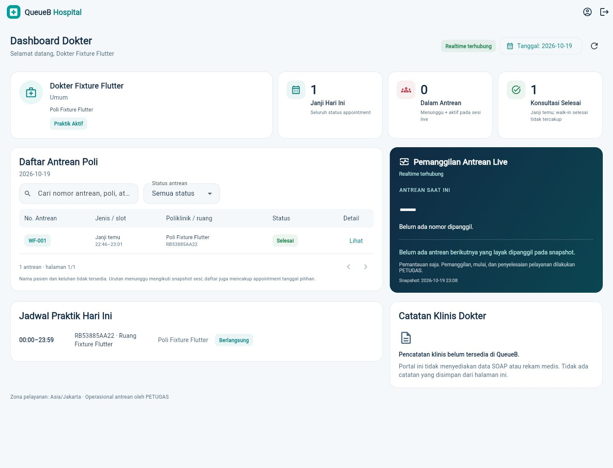
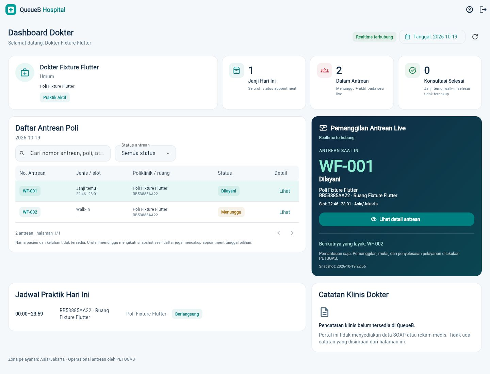
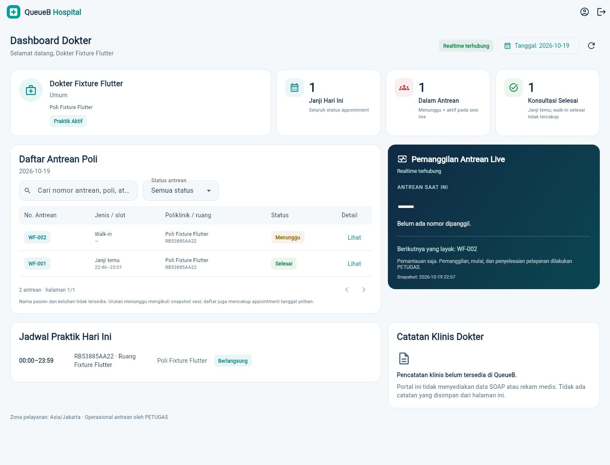

# Doctor Portal Web — dashboard satu halaman

Portal DOKTER existing kini menampilkan ringkasan profil/praktik, tiga KPI, daftar antrean, panel live, jadwal dan area catatan dalam satu halaman scrollable. Tidak ada navigasi tab mobile atau route baru. Layout desktop memakai dua kolom; lebar terbatas menumpuk panel dalam halaman yang sama. Tidak dibuat aplikasi/mobile dokter terpisah.

## Kontrak dan batas data

Keempat GET `/portal-dokter/profil`, `/jadwal`, `/janji-temu`, `/antrean/snapshot` tetap menjadi sumber data. Identitas dokter diturunkan server dari JWT. Flutter tidak mengirim `dokterId`, `penggunaId`, atau ID ruang sembarang untuk membaca monitoring. Snapshot hanya diminta untuk sesi sendiri yang aktif pada hari pelayanan dan berada dalam jendela waktu praktik. Penolakan 403 menghilangkan snapshot sesi tersebut.

- **Janji Hari Ini:** jumlah appointment pada tanggal pelayanan pilihan, termasuk seluruh status yang diberikan API. Judul berubah saat melihat tanggal lain.
- **Dalam Antrean:** total menunggu dari snapshot ditambah jumlah DIPANGGIL/DILAYANI pada sesi live yang dapat dipantau. Tanpa sesi live, tampil `—`, bukan nol pasien yang diasumsikan.
- **Konsultasi Selesai:** appointment dengan status tiket SELESAI pada tanggal pilihan. Respons portal tidak mencakup riwayat walk-in selesai; batas ini tertulis di kartu.
- Daftar menggabungkan appointment dan snapshot berdasarkan poli, ruang, nomor antrean. Status snapshot mengungguli status appointment sebelumnya tanpa menggandakan baris. Urutan menunggu serta `layakDipanggil` dipertahankan dari server. Snapshot menunggu dibatasi backend maksimal 100 per sesi; total dari server dapat lebih besar daripada baris yang tersedia.
- Panel live menampilkan nomor, status, poli/ruang/lokasi dan waktu slot jika memang tersedia. Jika beberapa antrean aktif ada, dokter bisa memilih nomor yang dipantau. Tidak ada perhitungan estimasi atau pemanggilan otomatis.
- API tidak menyediakan identitas pasien, keluhan, foto dokter, izin praktik/SIP, SOAP atau rekam medis. UI tidak membuat data pengganti. Area **Catatan Klinis Dokter** menjelaskan bahwa pencatatan belum tersedia dan tidak menyimpan input lokal.
- Detail antrean adalah dialog baca dari data yang sudah berwenang, tetap pada halaman yang sama. Tidak ada tombol START/COMPLETE/RECALL/CALL untuk DOKTER; operasional tetap domain PETUGAS.

## Realtime dan sesi

Feed `PatientUpdates` existing tetap memakai namespace `/doctor`, `doctor:ready` dan `doctor:updated`. Event adalah invalidasi; UI membaca ulang REST melalui RefreshGate, mempertahankan deduplikasi, debounce, rotasi token, reconnect/resume dan rekonsiliasi berkala existing. Indikator koneksi, loading, error dan keadaan kosong tampil eksplisit. Snapshot lama dibersihkan ketika pembacaan gagal atau sesi ditolak.

Persistent login, RBAC, global profile/logout, backend, database/migration, Queue Engine dan tampilan role lain tidak diubah. Waktu tetap mengikuti `SERVICE_TIME_ZONE`.

## Verifikasi

- Format check: **49 file, 0 perubahan**. Analyzer: **tanpa issue**.
- Seluruh regresi Flutter: **196 lulus, 1 integrasi bersyarat dilewati**. Termasuk 19 tes khusus portal/dashboard dokter.
- Pengujian tambahan memastikan setelah refresh gagal, percobaan ulang tidak menampilkan nol pada KPI sebelum REST selesai. Data lama yang ditolak atau gagal dibaca tidak dipakai sebagai snapshot aktif.
- Pencarian/filter tidak di-reset ketika loading realtime muncul. Pengujian menahan request REST lalu mengubah status datanya untuk memastikan pilihan dan nilai input tetap bertahan.
- Build utama Web release JavaScript: **berhasil**. Tidak ada perubahan dependency, backend atau schema/migration.
- QA REST nyata: identitas ADMIN, PETUGAS, USER, DOKTER valid; role selain DOKTER ditolak pada portal dengan **403**; mutasi antrean oleh DOKTER ditolak **403**; snapshot sesi sendiri **200**, tanpa identitas pasien.
- QA browser memakai akun/sesi dan NestJS existing pada `127.0.0.1:5433/capstone_antrean_test`. Harness lokal ignored memakai revalidasi cache yang dinonaktifkan dan timeout lebih panjang untuk instrumentasi IAB. REST langsung dan regresi Flutter menggunakan transport/deadline aplikasi normal; source aplikasi tetap memakai timeout existing. Pengujian deployment di browser reguler tetap dianjurkan.
- QA Web nyata: login DOKTER, jadwal dan appointment, monitoring appointment/walk-in, pencarian, detail baca, CALL/RECALL/START/COMPLETE oleh PETUGAS, invalidasi REST otomatis, reconnect, dan logout kembali ke formulir login **lulus**. Observer Socket.IO menerima enam invalidasi selama sesi awal; pemeriksaan baru dengan token segar juga menerima invalidasi COMPLETE walk-in dan mengonfirmasi snapshot aktif/menunggu menjadi kosong.
- Setelah kedua pelayanan selesai, API memberikan **0 menunggu, 0 aktif, 1 appointment selesai**. Walk-in selesai tidak ditambahkan ke KPI appointment.
- Cleanup hanya fixture unik pada database tes: **13 record existing identik, 0 hilang/berubah, 0 fixture tersisa**. Ke-42 file lokal di luar scope tetap identik. Tidak ada reset atau perubahan database utama.
- `git diff --check`: bersih. Target UI diuji pada desktop 1024/1366/1920 lewat widget test dan preview browser 1440×1100; regresi lebar sempit existing tetap lulus.

## Screenshot QA

Seluruh angka dan nama profesional di bawah berasal dari fixture API tes. Tidak ada identitas pasien, token atau kredensial dalam gambar.

| Appointment sedang dilayani | Appointment selesai |
| --- | --- |
|  |  |

## Panduan demo Web

1. ADMIN membuka **Dokter → Akun dokter**, kemudian membuat akun DOKTER atau menautkan akun DOKTER aktif existing. Profil dokter, relasi poli, ruang dan jadwal praktik harus aktif sesuai kontrak backend.
2. Buka Flutter Web dan login memakai akun tersebut. Route DOKTER langsung membuka dashboard satu halaman. Profil, status praktik dan ringkasan memakai data API; tidak ada parameter identitas dokter dari URL.
3. Siapkan appointment atau walk-in pada poli hibrida, lalu lakukan QR Check-In dan Masuk Antrean sebagai PETUGAS. Pilih sesi dokter yang memang berlangsung pada hari pelayanan.
4. PETUGAS melakukan CALL, RECALL, START dan COMPLETE. Dokter hanya memantau nomor/status, daftar dan KPI yang disegarkan dari REST setelah invalidasi Socket.IO.
5. Gunakan pencarian/filter atau **Lihat** untuk detail baca; tanggal dapat dipilih tanpa meninggalkan dashboard. Jika sesi belum mulai/berakhir atau tidak berwenang, panel live menampilkan keadaan tidak tersedia.
6. Putuskan dan pulihkan koneksi untuk melihat indikator realtime dan rekonsiliasi existing. **Keluar akun** tetap memakai logout/sesi global existing.

Build utama: `flutter build web --release --no-wasm-dry-run --dart-define=API_BASE_URL=http://localhost:3000/api/v1 --dart-define=SERVICE_TIME_ZONE=Asia/Jakarta`. Flag tersebut melewati preflight kompatibilitas Wasm opsional; target yang dibangun adalah Web JavaScript. Tidak ada build Android khusus dokter.

## Berkas utama

- `apps/client/lib/src/doctor.dart`: state dan pembacaan REST existing, sekarang memasang satu dashboard.
- `apps/client/lib/src/doctor_dashboard.dart`: model presentasi, panel profil/KPI, tabel berpaginasi/search/filter, detail baca, panel live, jadwal dan area catatan.
- `apps/client/test/doctor_portal_test.dart`: regresi route, scope baca, sesi dan realtime existing pada layout satu halaman.
- `apps/client/test/doctor_dashboard_test.dart`: penggabungan status REST, urutan/eligibility, 2.000 baris, desktop, beberapa ruang, detail baca, sesi ditolak dan login/logout.
