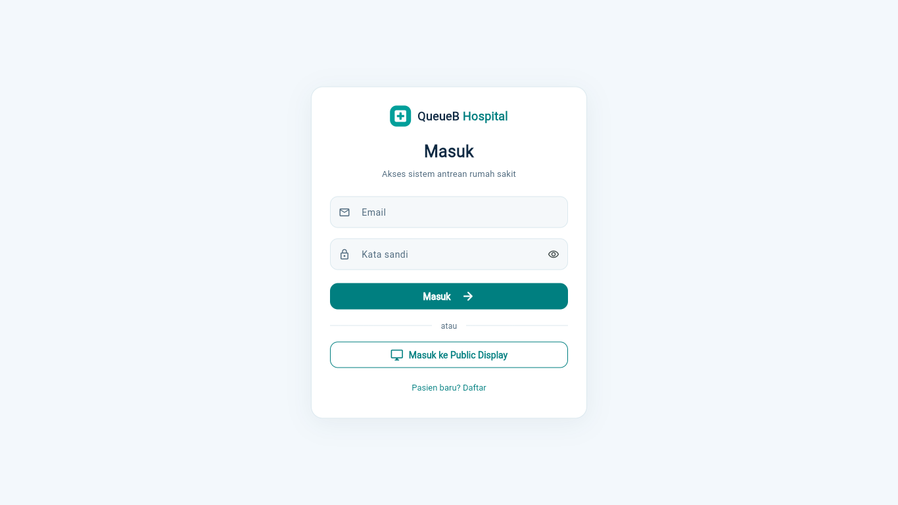
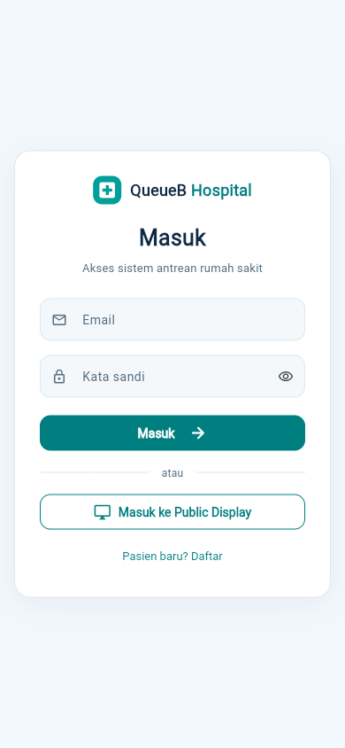

# Login Page V3 — centered, compact, responsive

Halaman login memakai card putih maksimum **420 px**, radius **18 px**, border tipis dan shadow lembut pada background putih kebiruan. Branding QueueB existing, judul 25 px, subjudul 13 px, input/tombol 14 px. Ilustrasi dan panel promosi tidak dirender; aset existing tidak dihapus. Referensi implementasi adalah spesifikasi tertulis Login V3 yang disetujui; gambar centered-card V3 baru tidak disertakan pada lampiran permintaan ini.

LoginPage tetap memiliki controller, validasi, submit, autofill, loading, password visibility dan navigasi existing. Perubahan app.dart hanya presentasi serta label live-region error/sukses agar SelectableText tetap diumumkan dengan jelas pada Web. API, JWT, session store, role redirect, backend, pairing dan dashboard lain tidak diubah. Form registrasi pasien existing mengikuti card yang sama dan tidak menambahkan input role.

LoginLayout memakai ukuran natural dan batas minimum tinggi viewport. Konten terpusat saat muat; scroll hanya memiliki extent bila viewport pendek, keyboard muncul, atau ukuran teks aksesibilitas membutuhkannya. Tidak memakai tinggi card tetap, IntrinsicHeight, transform scaling, animasi/dependency baru atau overflow clipping untuk menyembunyikan konten.

## Validasi

| Pemeriksaan | Hasil |
|---|---|
| Dart format seluruh client | PASS, tidak ada perubahan format tersisa |
| Flutter analyze | PASS, no issues |
| Seluruh Flutter test | 355 PASS, 1 live test opsional SKIP |
| Regresi khusus login | 24 PASS: validasi, loading, error, keyboard, resize, registrasi, Public Display, redirect/logout ADMIN/PETUGAS/DOKTER/USER |
| Web release JavaScript | PASS |
| Layout Chrome 1366x768, 1440x900, 1920x1080 | Seluruh aksi terlihat, tanpa scroll dokumen |
| Layout Chrome 768x1024, 360x800, 390x844 | Seluruh aksi terlihat, tanpa scroll dokumen |
| Widget layout tambahan 320, 375, 414, 500, 1024 px | Card terpusat, nol scroll extent pada kondisi normal |
| Chrome: validasi, show/hide, loading/klik ganda, error, registrasi dan Public Display | PASS dengan fixture HTTP |
| Keyboard pendek dan text scale 2 | Konten dapat discroll untuk aksesibilitas, tanpa overflow |

Pengujian role dan session memakai MockClient/FakeBackend existing, bukan login akun development sungguhan. Runner Chrome `apps/client/tool/browser-login-v3.cjs` merender build release nyata dengan **fixture HTTP terkontrol**, font/engine SDK lokal, dan profil browser sementara. Tidak menghubungi akun/database untuk registrasi atau login. Pengujian ini memastikan UI mengirim kontrak existing termasuk `kataSandi`, mempertahankan nilai input, mencegah submit ganda, serta membuka Public Display secara anonim. Tidak mengklaim pengujian perangkat Android fisik atau keyboard OS dari viewport Web.

Runner menerima `webUrl` loopback, `output`, `engineRoot` (CanvasKit SDK), dan `fontFile` (Roboto SDK); memerlukan Google Chrome dan @playwright/test pada tooling QA, tanpa menambah dependency aplikasi. Serve `apps/client/build/web` pada HTTP lokal, lalu panggil exported runner. Hasil machine-readable: [login-v3-browser-qa.json](login-v3-browser-qa.json).

Peringatan dry-run WASM existing pada flutter_tts/socket_io_common tetap ada; build yang diverifikasi adalah Web release JavaScript. Seluruh 28 file lokal pengguna dan backup tetap dipertahankan. Tidak ada perubahan source pada checkout utama selama implementasi terisolasi.

## Screenshot Chrome release

Setelah PR disetujui dan di-merge, sinkronkan checkout yang dipakai menjalankan aplikasi dan restart Flutter agar browser memuat Login V3. Server localhost:5173 yang digunakan pengguna tidak diganti oleh server QA pada pekerjaan ini.
