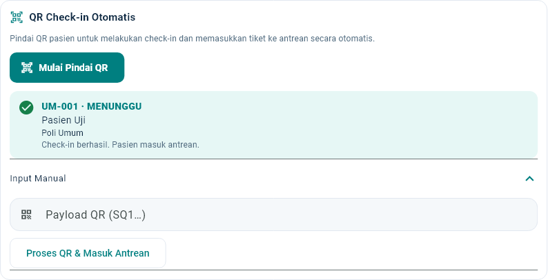
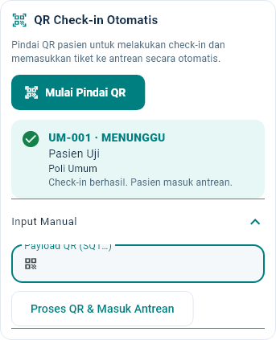

# One-Scan QR Check-in & Auto-Enqueue

Alur lama: scan → Check-In → CHECK_IN → Masuk Antrean → MENUNGGU.

Alur baru: scan QR lengkap → validasi dan transaksi server atomik → MENUNGGU. Tidak ada konfirmasi scan kedua atau klik Masuk Antrean pada alur normal.

## Implementasi

Backend menambah `POST /check-in/auto-antrean` khusus PETUGAS, mempertahankan endpoint legacy, memakai callback transaksi existing untuk CHECK_IN/ENQUEUE, counter dan audit pada satu transaksi Serializable. Event ENQUEUE dikirim setelah commit. Seluruh validasi Hospital, tanggal, jam, role dan assignment tetap berlaku. Tidak ada migration.

Portal PETUGAS menambah tombol Mulai Pindai QR, kamera berkelanjutan, indikator proses dan hasil terakhir dengan nama/poli/status yang dikonfirmasi backend. QR lengkap baru dikirim; frame ganda dikunci. Kegagalan perlu retry eksplisit, bukan loop request. Kamera berikutnya dapat membaca QR berbeda. Audio sistem opsional tidak menahan proses. Lifecycle observer dan controller dibersihkan saat keluar. Input manual ditutup secara default dan status ekspansinya dipertahankan saat error/snapshot berubah.

Kontrak, expiry, idempotensi dan batas pemulihan CHECK_IN historis: [Bagian 26 API Guide](../backend/API_INTEGRATION_GUIDE.md#26-one-scan-qr-check-in-dan-auto-enqueue). Hash bukti hanya di audit internal; tidak pernah menyimpan token asli di database/log. QR yang expired tidak diperpanjang oleh retry.

## Cara demo

1. Deploy backend dan Flutter dari PR yang sama. Tidak perlu migration atau perubahan database development.
2. Login PETUGAS dengan penugasan aktif; pilih ruang/poliklinik yang sesuai.
3. Pasien menerbitkan QR pada hari pelayanan; tekan Mulai Pindai QR lalu berikan izin kamera browser/platform.
4. Arahkan kamera ke QR. Hasil harus MENUNGGU dan langsung terlihat di waiting list; arahkan ke QR pasien berikutnya.
5. Pantau Public Display V3 dan Portal Dokter pada sesi/ruang yang sah. ENQUEUE memperbarui snapshot, tanpa TTS panggilan.
6. Jika kamera tidak tersedia, buka Input Manual dan tempel QR utuh lalu tekan Proses QR & Masuk Antrean. Pengetikan tidak mengirim request.
7. Jalur pemulihan ID tiket dan SKIP/REQUEUE lama tetap tersedia untuk kasus legacy/operasionalnya.

## QA

Hasil pengujian 26 Oktober 2026:

| Pemeriksaan | Hasil |
|---|---|
| Unit backend | 674 PASS (45 suite) |
| Seluruh E2E backend | 379 PASS (31 suite), termasuk 16 One-Scan |
| Flutter seluruh role | 351 PASS, 1 live fixture opsional SKIP |
| Regresi QR/scanner/PETUGAS final | 12 PASS |
| Lint, type check dan NestJS build | PASS |
| Flutter analyze dan format | PASS |
| Web release dan APK release arm64 | PASS; APK arm64 split ABI 30.307.513 byte (28,9 MiB) |

Baseline E2E: 13 record existing identik; 0 berubah, 0 hilang, 0 fixture tersisa. Tidak ada migration.

 Seluruh E2E memakai `127.0.0.1:5433/capstone_antrean_test`, target diverifikasi sebelum fixture dibuat dan baseline diperiksa kembali sesudahnya. Tidak ada pengujian yang menulis database development.

E2E baru mencakup walk-in harian/HIBRIDA, appointment dengan slot berakhir tetapi sesi aktif, expiry, tanggal/poli salah, role USER/ADMIN/DOKTER, status dipanggil/dilayani/selesai/batal/dilewati, CHECK_IN legacy, scan ulang/concurrent, rollback ketika enqueue gagal, assignment/sesi nonaktif, expiry bukti terpakai dan empat namespace realtime. Monitoring dokter tetap memakai kontrak minimal tanpa tiketId/patient identity.

Tes Flutter mencakup format QR parsial, frame paralel, frame sama, pasien berikutnya, tutup/buka kamera, callback setelah disposal, offline+retry, input manual tanpa autosubmit, data respons server dan snapshot, serta layout desktop/mobile. Regresi semua role, pairing, TTS, QR, booking dan prioritas tetap dijalankan.

Screenshot berikut dirender Flutter memakai **fixture sintetis QA** dengan font Roboto, bukan data pasien atau hasil tes perangkat fisik:





### Batas verifikasi

ADB tidak mendeteksi perangkat Android saat pemeriksaan. Kamera/izin browser, fokus/lensa kamera ponsel, dan bunyi sistem nyata perlu smoke test perangkat saat pemasangan. Sistem tetap menyediakan manual fallback bila kamera/audio tidak didukung. Build APK demo memakai konfigurasi API existing; untuk perangkat fisik, build dengan API_BASE_URL yang dapat dijangkau HP dan kebijakan HTTPS/cleartext sesuai lingkungan. Tidak mengklaim pengujian kamera fisik.

Socket.IO tetap best effort dengan REST fallback. Request yang commit tetapi responsnya hilang dapat dipindai ulang selama expiry semula; MENUNGGU dikembalikan tanpa urutan kedua. QR legacy historis tanpa bukti audit tidak dapat direkonstruksi; gunakan pemulihan tiket existing. Endpoint lama dan seluruh data/backup pengguna dipertahankan.


### Berkas perubahan

- Backend: `check-in.controller.ts`, `check-in.module.ts`, `check-in.service.ts`, `auto-check-in.service.ts`, `queue.service.ts` dan tes terkait. Callback ENQUEUE existing diekstrak untuk komposisi transaksi, tanpa mengganti selector/State Machine.
- Flutter: `queue.dart`, `staff_qr_scanner.dart`; tes `ui_test.dart`, `staff_dashboard_v3_test.dart`, `one_scan_qr_test.dart`.
- Dokumentasi: API Guide Bagian 26, panduan ini dan dua capture panel QA.

Optimasi aset/tema, realtime dan Display V3 tetap dipertahankan. APK memakai split debug info dan split ABI; simbol tetap lokal. Peringatan dependency existing terkait WASM interop dan migrasi Kotlin Gradle Plugin flutter_tts dicatat, tanpa upgrade di luar scope.


Perintah build final:

```powershell
flutter build web --release
flutter build apk --release --split-per-abi --target-platform android-arm64 --split-debug-info=../../tmp/one-scan-symbols
```

Artefak Android lokal: `apps/client/build/app/outputs/flutter-apk/app-arm64-v8a-release.apk`. File build, simbol dan log tidak dimasukkan Git. Konfigurasi/signing Android existing dipertahankan.
