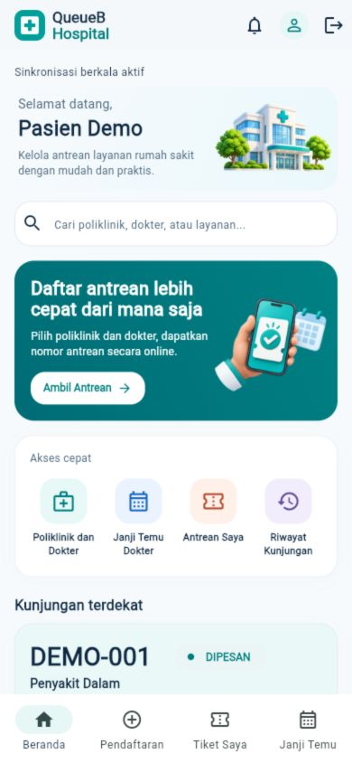
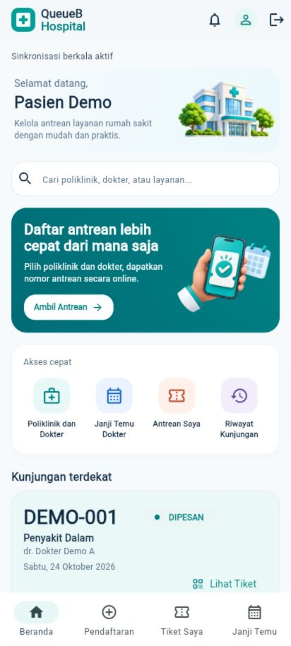
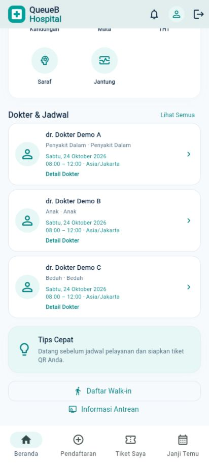

# Beranda Pasien V3

Redesign terbatas pada Beranda USER Flutter, dengan warna QueueB, ilustrasi lokal, dan navigasi existing. Tidak ada perubahan backend, schema, database, autentikasi, Queue Engine, atau halaman role lain.

## Perubahan

- Header beranda: branding, ikon aktivitas tiket tanpa badge fiktif, avatar profil, serta logout existing.
- Sapaan dari identitas pengguna; ilustrasi rumah sakit dan pencarian poliklinik/dokter/spesialisasi.
- Banner pendaftaran dengan satu CTA `Ambil Antrean`, tanpa carousel otomatis.
- Empat shortcut: poliklinik/dokter, appointment, tiket, dan riwayat. Seluruh tujuan bottom navigation existing dipertahankan; SafeArea tetap berlaku.
- Kunjungan terdekat dari tiket/appointment milik pengguna, diurutkan berdasarkan tanggal pelayanan dan waktu slot jika tersedia. Snapshot tiket terkini lebih diutamakan dari salinan tiket dalam appointment. Tiket selesai/dibatalkan/tanggal lampau dikecualikan dari ringkasan ini.
- Grid poliklinik API; maksimal tiga ringkasan dokter aktif dengan relasi poliklinik aktif. Jadwal relevan diurutkan dari sesi yang belum berakhir, mengikuti zona pelayanan. Jika jadwal gagal dibaca, tampilkan informasi kegagalan, bukan ketersediaan buatan.
- Loading skeleton, empty state, tips QR umum, akses walk-in, dan Informasi Antrean existing.

Komponen visual ada di `patient_home.dart`. `patient.dart` tetap memiliki state booking dan PatientUpdates/RefreshGate existing. Header USER dirender dalam PatientPage agar hanya Beranda memakai varian baru; halaman pasien lain tetap memakai header existing. Header role lain tidak berubah.

## Integrasi data

Memakai GET `/layanan`, `/dokter`, `/jadwal-praktik`, `/tiket/saya`, `/janji-temu` existing. Ringkasan jadwal melakukan satu pembacaan katalog jadwal per rekonsiliasi overview; tidak membaca slot untuk setiap kartu dokter. Kontrak saat ini menyediakan daftar jadwal tanpa pagination/rentang tanggal, sehingga filter tampilan dilakukan lokal. Detail/booking tetap membaca jadwal dan slot dengan filter existing ketika dibuka.

Tidak ada rating, angka notifikasi, estimasi antrean, jumlah dokter praktik, atau jam layanan yang direkayasa. Ikon lonceng membuka daftar tiket, bukan fitur notifikasi baru. Jadwal dan kunjungan tidak dianggap tersedia hanya karena layout membutuhkannya.

## QA

| Pemeriksaan | Hasil |
| --- | --- |
| Dart format seluruh aplikasi | PASS |
| Flutter analyze | PASS, tidak ada issue |
| Flutter test | 263 PASS, 1 skip existing |
| Build Web release (`lib/main.dart`) | PASS |
| APK debug (`lib/main.dart`) | PASS |
| Widget responsif | 320, 360, 375, 390, 412, 414, 768 px PASS; nama panjang |
| Browser Flutter | 390×844 dan 412×915, CTA/Detail Dokter, grid dan kartu jadwal diperiksa |
| Android fisik | Tidak tersedia: `adb devices` kosong |
| `git diff --check` | PASS |
| Perlindungan pekerjaan lokal | 51 file root dibandingkan SHA-256, seluruhnya identik |

Tes baru mencakup pencarian, shortcut, header profil/logout, pembukaan detail dokter, pemilihan kunjungan terdekat, status tiket setelah rekonsiliasi REST, loading/kegagalan jadwal, dan layout tanpa overflow. Regresi existing meliputi booking appointment, walk-in, QR, sesi/logout, kalender/slot, pembatalan, operasi petugas, serta Public Display. Satu tes live existing dilewati karena harus dijalankan terpisah dengan database test tervalidasi; pekerjaan visual ini tidak menjalankan pengujian tulis database.

Preview screenshot menggunakan HTTP fixture terisolasi (`Pasien Demo`, `DEMO-001`) untuk melindungi data development. Fixture entry dan server preview ada di `.dart_tool` yang diabaikan Git; keduanya tidak masuk entry produksi atau PR. Screenshot adalah render aplikasi Flutter, bukan mockup atau frame ponsel buatan. Pemeriksaan ini tidak diklaim sebagai login/pemesanan live ke database development atau smoke test Android fisik.

## Demo

1. Jalankan backend dan Flutter dengan API_BASE_URL/SERVICE_TIME_ZONE existing, lalu login USER.
2. Periksa nama akun, cari dokter atau poliklinik, buka kartu dokter untuk Detail Dokter existing.
3. Pilih `Ambil Antrean` atau `Janji Temu Dokter`, lanjutkan booking existing sampai tiket QR. `Daftar Walk-in` tetap tersedia.
4. Kembali ke Beranda: kunjungan mendatang menampilkan data tiket aktual; `Lihat Tiket` membuka tiket/QR existing.
5. Perubahan status dari operasional petugas direkonsiliasi melalui mekanisme PatientUpdates existing; jika socket terputus fallback/pemulihan tetap dipertahankan.
6. Uji bottom navigation, riwayat, profil, dan logout.

## Aset dan batasan

Dua ilustrasi (`assets/illustrations/patient_hospital.png`, `patient_ticket.png`) dibuat khusus dengan tool imagegen built-in, background transparan, tanpa mengambil aset pihak ketiga. Prompt lengkap tersimpan dalam `images/patient-home-v3/ASSET_PROVENANCE.json`. Ilustrasi tiket dekoratif tidak memiliki nomor atau QR yang dapat dipakai.

Palette baru beranda terpusat di PatientHomeStyle, memakai token QueueBStyle existing untuk branding/status. Kontras putih pada kedua ujung gradient banner 6.17:1 dan 4.69:1, memenuhi WCAG 4.5:1; pemeriksaan visual mencakup hierarki, teks panjang, konsistensi, fokus Material, dan tidak adanya metrik buatan.

Build Web memakai target JavaScript existing. Peringatan Wasm dry-run pada dependency flutter_tts/socket_io_common existing tidak ditangani dalam perubahan halaman ini. Pengujian fisik Android dan smoke test memakai akun USER live dapat dilakukan saat perangkat/sesi tersedia.

Build APK juga menampilkan peringatan KGP dari flutter_tts dan native-access Java/Gradle existing. APK berhasil; dependency tidak diubah dalam scope beranda. Artefak: `apps/client/build/web` dan `apps/client/build/app/outputs/flutter-apk/app-debug.apk` (diabaikan Git). Cache Android `.kotlin` hasil build tidak di-stage.
