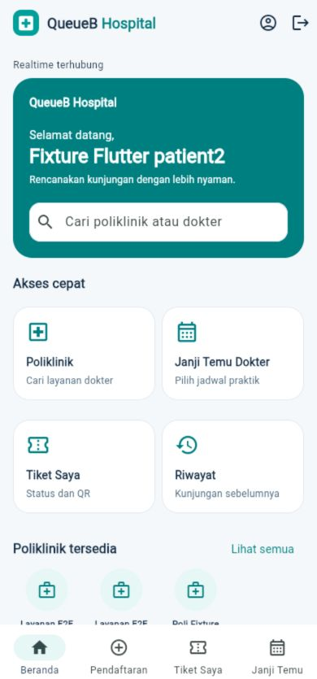
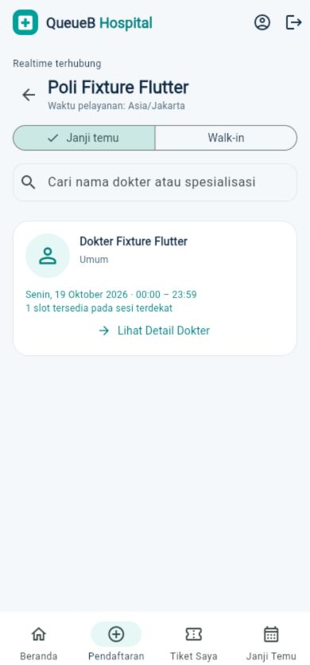
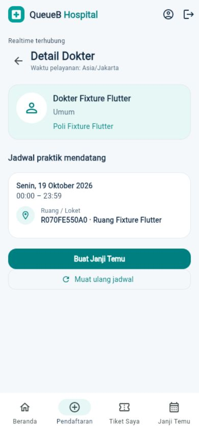
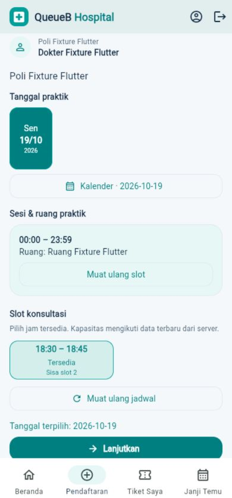
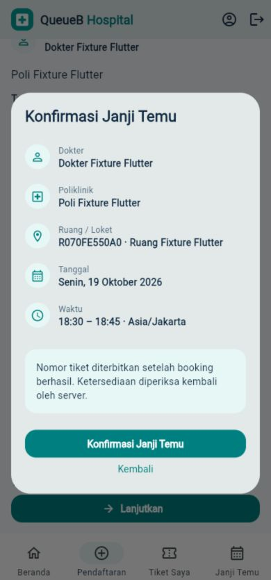
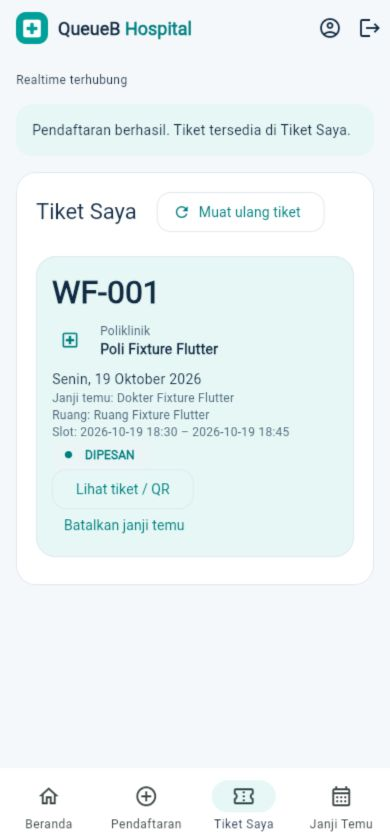
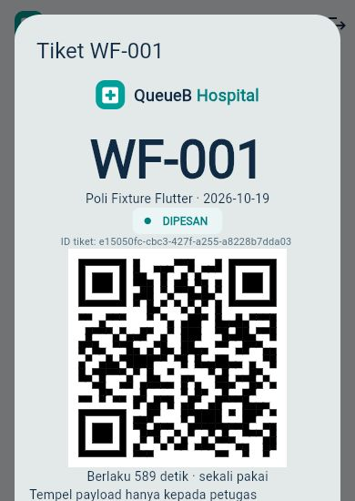
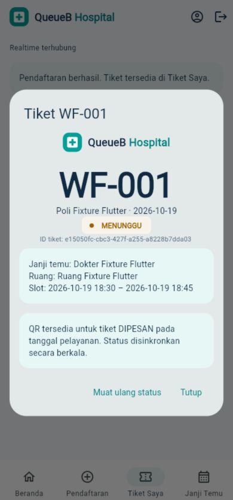

# Pasien & Doctor Booking Experience V2

Scope hanya Flutter pasien existing. Kontrak: [API Integration Guide](../backend/API_INTEGRATION_GUIDE.md), terutama Bagian 17 dan 18. Tidak ada perubahan backend, schema, migration, role, atau tampilan ADMIN/PETUGAS/DOKTER/Display.

## Desain dan navigasi

Komposisi mengikuti dua referensi QueueB dari Project Lead: beranda dengan sapaan dan pencarian pada header teal; katalog poliklinik berbasis API; daftar dokter per poli; profil dokter; pemilihan sesi/slot bertanggal; konfirmasi; serta tiket digital. Navigasi bawah existing dipertahankan. Riwayat dapat dibuka dari akses cepat beranda; walk-in dan akses Public Display tetap tersedia.

Token visual memakai `QueueBStyle` existing: teal `#009F9A`, dark teal `#007F80`, navy `#102A43`, mint, putih, dan background soft gray. Material 3, tipografi existing, kartu rounded, placeholder avatar profesional, ikon Material, serta state native focus/pressed/disabled tetap digunakan. Desain dibatasi pasien; tidak ada penggantian theme global atau dependency UI baru. Referensi foto, rating, pengalaman, biaya, dan statistik tidak ditiru karena API tidak menyediakannya.

## Sumber data dan aturan integrasi

- Beranda mengambil `/layanan`, `/dokter`, `/tiket/saya`, dan `/janji-temu`. Jumlah poli mengikuti respons; sebelas poli bukan hardcode. Poli/dokter nonaktif dan relasi dokter–poli yang tidak aktif tidak ditawarkan.
- Memilih poli membuka daftar dokter terkait dengan pencarian nama/spesialisasi. Ringkasan sesi terdekat berasal dari `/jadwal-praktik?layananId=…`. Preview slot membaca sesi terdekat tiap dokter dengan maksimal empat request paralel; kegagalan baca tidak diubah menjadi status penuh atau tersedia palsu.
- Detail dokter menampilkan hanya profil master, poli terpilih, sesi bertanggal, waktu, dan ruang aktual. Tidak ada pola mingguan buatan. Informasi dokter tetap dapat dibaca pada poli ANTREAN_HARIAN; tombol appointment dibatasi mode reservasi.
- Kalender horizontal hanya berisi tanggal sesi API. Tanggal tetap diperlakukan sebagai DATE; timestamp sesi/slot ditampilkan melalui `AppConfig` menggunakan `SERVICE_TIME_ZONE`.
- Pemilihan sesi mengambil ulang `/slot-praktik?jadwalPraktikId=…`. Slot penuh, tidak aktif, atau `tersedia != true` tidak dapat dipilih. Grid menampilkan sisa kapasitas dari respons.
- Lanjutkan membuka ringkasan dokter, poli, tanggal, ruang, waktu dan timezone. Tidak ada nomor/estimasi antrean sebelum booking. Perubahan pilihan/ketersediaan selama konfirmasi membatalkan submit dan meminta pilihan ulang.
- Konfirmasi mengirim `POST /janji-temu` dengan **hanya** `slotPraktikId`. ID appointment tidak digunakan sebagai ID tiket. Setelah sukses, Tiket Saya menampilkan nomor dan status aktual backend.
- Walk-in tetap memakai `POST /reservasi` dengan `layananId` dan `tanggalAntrean`; HIBRIDA tetap mendukung kedua kanal. Tidak ada blind retry POST ketika respons hilang; tiket milik sendiri diambil ulang.
- Pembatalan appointment tetap memakai ID janji temu dan aturan DIPESAN backend. QR tetap memakai ID tiket, tanggal pelayanan, status, masa berlaku dan payload backend existing.
- `PatientUpdates`/`RefreshGate` existing tetap mengatur satu koneksi `/patient`, invalidasi REST, polling fallback, reconnect, serta foreground reconciliation. Event bukan sumber nomor/status tiket. Penyimpanan sesi dan autentikasi tidak diubah.

## Pengujian

Regresi mencakup 320, 375, 414 dan 768 logical pixel; tanggal API, timezone, relasi dokter/poli, slot penuh/nonaktif, konflik 409, data berubah saat konfirmasi, ID appointment/tiket berbeda, pembatalan, QR, riwayat, serta regresi role lain.

Integrasi yang menulis data hanya dijalankan melalui harness existing pada `127.0.0.1:5433/capstone_antrean_test`. Harness memverifikasi identitas database sebelum fixture dibuat, membersihkan hanya fixture unik milik tes, dan membandingkan hash record existing sesudahnya. Tidak ada reset atau migration dalam pekerjaan ini.

Perintah dari `apps/client`:

```powershell
dart format --output=none --set-exit-if-changed .
flutter analyze
flutter test
flutter build web --release --no-pub --output build/web_patient_v2 --dart-define=API_BASE_URL=http://localhost:3000/api/v1 --dart-define=SERVICE_TIME_ZONE=Asia/Jakarta
flutter build apk --debug --no-pub --dart-define=API_BASE_URL=http://localhost:3000/api/v1 --dart-define=SERVICE_TIME_ZONE=Asia/Jakarta
```

API localhost pada APK memerlukan `adb reverse tcp:3000 tcp:3000` ke host development. Untuk pemasangan tanpa USB, build ulang dengan `API_BASE_URL` host API yang dapat dijangkau perangkat; jangan menyisipkan token/kredensial pada URL atau build.

## Hasil aktual — 19 Oktober 2026

| Pemeriksaan | Hasil |
|---|---|
| Format | 47 file, 0 perubahan tambahan |
| Flutter analyze | PASS, tidak ada masalah |
| Seluruh Flutter test | 185 PASS, 1 SKIP; termasuk 12 kasus baru pasien V2 |
| Web JavaScript release | PASS, output `build/web_patient_v2` |
| APK debug | PASS, output `build/app/outputs/flutter-apk/app-debug.apk` |
| REST integrasi nyata | PASS: appointment/walk-in → QR → CHECK_IN → ENQUEUE → CALL/RECALL/SKIP/REQUEUE → START → COMPLETE, realtime, refresh sesi, dan penolakan pemakaian ulang QR |
| Browser UI → backend test nyata | PASS: pilih poli/dokter → detail → sesi/slot → konfirmasi → tiket WF-001 → QR; ID appointment berbeda dari tiket |
| Realtime UI | PASS: setelah CHECK_IN/ENQUEUE fixture melalui API, dialog pasien otomatis berubah DIPESAN → MENUNGGU dan QR disembunyikan tanpa menekan refresh |
| Integritas fixture | Setiap run memverifikasi 13 record existing identik, 0 hilang/berubah, 0 fixture tersisa setelah cleanup |
| Pekerjaan lokal existing | 42 file tetap identik dan tidak disertakan commit |

Instrumentation Android dicoba pada emulator Android 11 yang tersedia, tetapi berhenti sebelum menjalankan aplikasi karena ABI **x86 unsupported** oleh Flutter saat ini. Tidak ada perangkat fisik sesuai pilihan Project Lead. Screenshot berikut adalah **Flutter Web mobile 390×844**, bukan screenshot Android; tes kamera Android dan runtime pada perangkat Android masih perlu dijalankan pada perangkat/AVD berarsitektur yang didukung. Skrip instrumentation existing sudah disesuaikan dengan navigasi dan konfirmasi baru.

Build mencatat warning dependency existing: kompatibilitas WebAssembly pada `flutter_tts`/`socket_io_common`, serta migrasi Built-in Kotlin untuk `flutter_tts` pada versi Flutter mendatang. Web JavaScript dan APK debug tetap berhasil. Tidak ada upgrade dependency atau perubahan Gradle dalam scope ini.

## Screenshot dari backend test nyata

Nama, poli dan jadwal di bawah merupakan fixture unik database test. Tidak ada data pasien development/production digunakan. QR screenshot berasal dari fixture yang telah dibersihkan, sehingga tidak dapat dipakai kembali. Screenshot QR dipotong sebelum teks payload; tidak ada sandi atau token sesi dalam artefak.

### Beranda



### Dokter per poliklinik



### Detail dokter



### Jadwal dan slot



### Konfirmasi



### Tiket dan QR





### Pembaruan realtime


