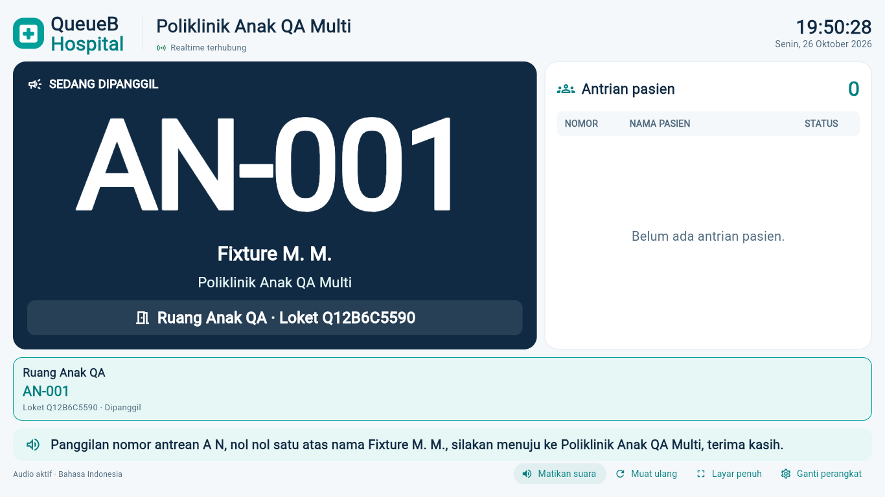
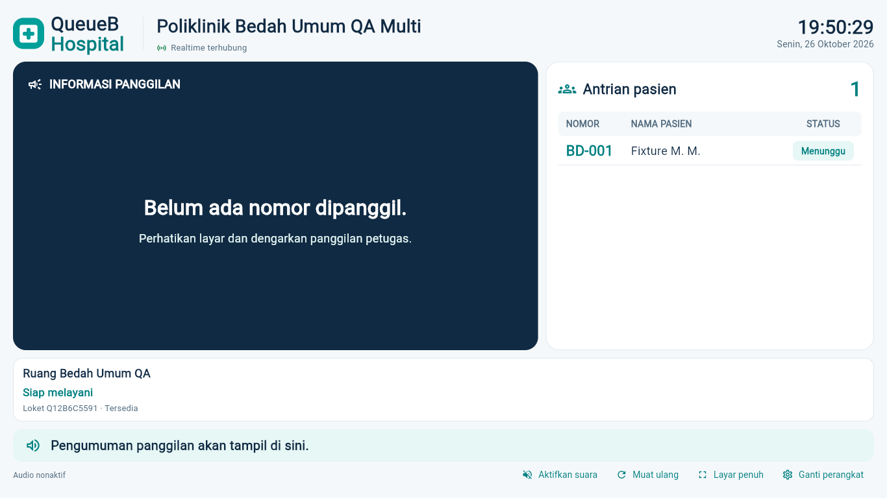

# PR #71 — verifikasi akhir multi-monitor

Runtime: Google Chrome **155.0.8059.86**, Playwright, Flutter Web release dari branch PR #71. Dua proses/profil Chrome persisten sementara dengan empat halaman display; semua profil fixture terpisah dari profil pengguna. Aplikasi/backend QA hanya mengakses 127.0.0.1:5175 dan 127.0.0.1:3003, dengan database **127.0.0.1:5433/capstone_antrean_test**. API dan Socket.IO nyata, tanpa stub data/response antrean. Font SDK lokal dipakai untuk request font statis. TTS id-ID dikontrol oleh test double untuk memeriksa dispatch/deduplikasi, bukan klaim bunyi speaker fisik.

| Skenario browser | Hasil |
|---|---|
| Profil 1: tab A Anak, B Bedah aktif bersamaan | PASS |
| Pairing, selector tab dan cookie A/B/C independen | PASS |
| Profil 2: monitor D Anak, cookie terpisah dari profil 1 | PASS |
| Tiga monitor Anak A/C/D menerima CALL dan RECALL konsisten | PASS |
| Bedah tidak menerima invalidasi Anak | PASS |
| SKIP tampil Dilewati, REQUEUE kembali Menunggu tanpa duplikasi | PASS |
| Reload A membuat koneksi socket baru; B/C/D tetap pada koneksi awal | PASS |
| Reload tidak mengucapkan panggilan historis | PASS |
| Rotasi dan pairing ulang A tidak memutus B/C/D | PASS |
| Nonaktifkan A mengosongkan snapshot A dan menjelaskan alasan; B/C/D tetap live | PASS |
| Selector B tanpa credential B pada profil 2 | 401 sesuai harapan |
| Credential A meminta poliklinik Bedah | 403 sesuai harapan |
| Tidak ada 401/403 tidak diharapkan pada halaman display | PASS |
| Cookie HttpOnly/Strict, UUID saja di sessionStorage, tidak ada token di JS/storage/URL/auth socket | PASS |
| Cookie Secure production dan host-only; cookie duplikat/tanpa selector tidak fallback | PASS |
| Audio hanya diaktifkan pada A, monitor lain tetap nonaktif | PASS |
| 1280x720, 1366x768, 1920x1080 tanpa scroll dokumen | PASS |

[Data lengkap dan jumlah koneksi/event](pr71-browser-qa.json). Satu fetch yang dibatalkan Chrome tercatat terpisah sebagai ERR_ABORTED; tidak dinyatakan sebagai respons HTTP berhasil. Semua pemeriksaan akhir UI, snapshot autentik dan socket tetap lulus; tidak ada request failure lainnya, respons API 5xx, atau error console aplikasi pada run akhir.

## Perbaikan yang ditemukan selama QA

Batas transaksi baca snapshot Prisma default 5 detik terbukti menghasilkan P2028 (7,2 detik teramati). Batas eksekusi dinaikkan ke **15 detik**, tetap RepeatableRead, tanpa retry mutasi, tanpa perubahan max-wait existing dan dengan budget total di bawah timeout klien 20 detik. Tidak ada perubahan schema/migration, Queue Engine, RBAC maupun aturan pelayanan.

Harness diperbaiki untuk mengaktifkan semantics bila diperlukan, memasukkan kode lewat keyboard Flutter, memberi fokus sebelum capture/resize, dan tidak menganggap body DevTools yang dibuang saat lifecycle sebagai error aplikasi. Verifikasi tetap memeriksa request/response nyata, identitas header, hasil UI, snapshot melalui cookie browser, serta semua error HTTP; 5xx tidak diabaikan. Percobaan awal yang gagal tidak dilabeli PASS.

## Bukti Chrome (data sintetis)

[Monitor Anak lain pada profil sama](images/display-multi-monitor/chrome-same-clinic-1366.png) · [Profil Chrome kedua](images/display-multi-monitor/chrome-profile-2-1366.png) · [1280x720](images/display-multi-monitor/chrome-layout-1280.png) · [1920x1080](images/display-multi-monitor/chrome-layout-1920.png).

## Reproduksi/manual checklist untuk pemasangan

1. Jalankan API dan Flutter dari versi yang sama pada lingkungan lokal/test yang terverifikasi. Jangan memakai production untuk pengujian mutasi.
2. ADMIN siapkan empat perangkat test: A Anak, B Bedah, C Anak, D Anak. Gunakan kode baru per perangkat; jangan salin token atau kode ke URL/log/screenshot.
3. Pada profil Chrome 1, buka tiga tab baru, bukan Duplicate Tab. Pair A/B/C masing-masing. Pada profil 2 pair D. Veriksa cookie metadata melalui DevTools tanpa menyalin nilainya; sessionStorage harus hanya memuat UUID perangkat tab terkait.
4. PETUGAS jalankan CALL, RECALL, SKIP, REQUEUE pada fixture Anak. A/C/D harus konsisten; B tetap Bedah. Refresh A dan pastikan B/C/D tidak terputus atau pindah poli.
5. ADMIN rotasi A, pair ulang A, lalu nonaktifkan A. Hanya A ditolak. Jangan menguji pencabutan pada perangkat pelayanan existing.
6. Periksa 1280x720, 1366x768 dan 1920x1080 tanpa scroll; cek tidak ada 401/403 selain penolakan yang disengaja. Aktifkan suara sendiri pada tiap TV yang memerlukannya.
7. Untuk speaker fisik, konfirmasi voice id-ID tersedia dan terdengar. Bukti otomatis memakai voice test double; tidak menggantikan pemeriksaan perangkat fisik.

Runner browser: apps/client/tool/browser-display-multi-monitor.cjs, menerima fixture dari harness database test yang memvalidasi target dan baseline. Credential fixture hanya berada dalam file privat yang diabaikan Git; hasil publik tidak memuat token/kode. Semua fixture akhir dibersihkan berdasar ID milik tes; **13 record baseline identik, tanpa perubahan/hilang atau fixture tersisa**. Seluruh 28 file lokal pengguna dan backup tetap dipertahankan.

## Regresi setelah perbaikan timeout

Unit backend **676 PASS** (45 suite), seluruh E2E **383 PASS** (31 suite), lint/typecheck dan build NestJS PASS. Baseline test kembali **13 record identik**, nol fixture tersisa. Dart/UI aplikasi tidak berubah; baseline Flutter 354 PASS dan 1 live test opsional SKIP serta build Web release tetap berlaku, dan CI akan memverifikasi HEAD final.
