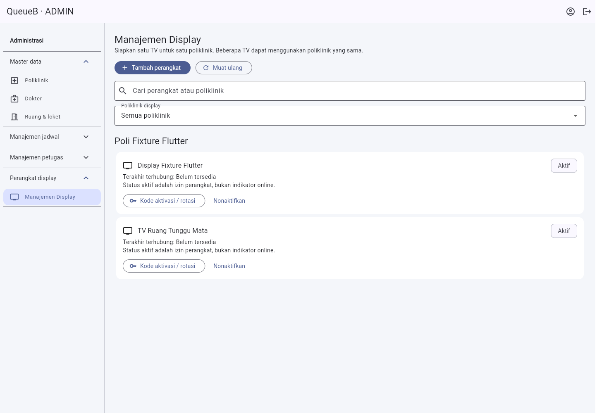
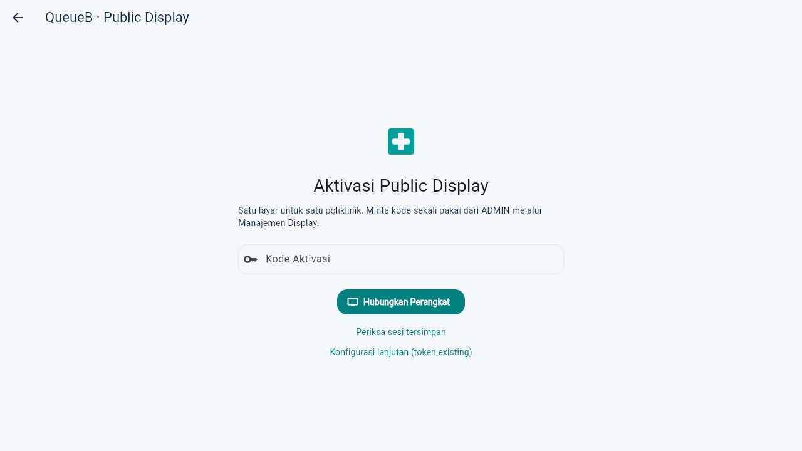
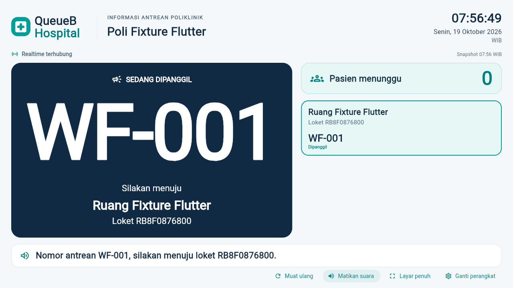

# QueueB — Manajemen perangkat dan aktivasi Public Display

Tanggal: 19 Oktober 2026. Branch: `feature/public-display-device-pairing`.

## Menyiapkan TV

1. ADMIN login Flutter → **Perangkat display → Manajemen Display**.
2. **Tambah perangkat**, isi nama yang mudah dikenali, pilih poliklinik aktif, Simpan perangkat.
3. Pilih **Kode aktivasi / rotasi**, baca konfirmasi pencabutan kredensial lama, lalu Lanjutkan.
4. Berikan kode **12 digit** melalui saluran aman. Kode hanya ditampilkan satu kali, berlaku lima menit; jangan memotret/merekam popup atau membagikan kode lewat URL.
5. Pada browser TV terpisah buka `/#/display` (atau Buka Public Display dari login), masukkan kode → **Hubungkan Perangkat**. TV tidak membutuhkan login akun atau UUID.
6. Pastikan nama poliklinik dan status realtime benar. Aktifkan suara Indonesia dan Layar penuh melalui tombol pada display. Audio/fullscreen mungkin perlu diaktifkan lagi setelah reload sesuai browser.
7. Refresh atau restart browser dengan profil normal yang sama: cookie HttpOnly memulihkan perangkat, snapshot pertama tetap senyap. Cookies/private-mode yang dibersihkan atau sesi 30 hari yang habis memerlukan kode baru.

Satu perangkat hanya menampilkan satu poliklinik; satu poliklinik bisa memiliki beberapa TV. Gunakan profil browser terpisah untuk TV berbeda; cookie perangkat terikat host API. `Aktif` adalah izin, bukan bukti TV online. Terakhir terhubung berasal dari pairing/pemeriksaan sesi, bukan heartbeat. UUID/hash tidak ditampilkan sebagai informasi utama.

## Konfigurasi jaringan

- Produksi: utamakan Web/API satu origin HTTPS melalui reverse proxy; teruskan upgrade `/socket.io`. Alternatif subdomain satu situs HTTPS dengan CORS allowlist spesifik (termasuk port) dan credentials. Cookie HttpOnly + SameSite=Strict + Secure, host-only, Path=/.
- HTTP localhost untuk demo: Web dan API harus memakai host yang sama, misalnya `127.0.0.1:8080` dan `127.0.0.1:3000`, atau keduanya localhost. Jangan mencampur localhost dengan 127.0.0.1. Jangan gunakan origin `null`/file://.
- Pairing lintas situs tidak didukung; jangan menurunkan SameSite atau menyimpan token plaintext di localStorage untuk mengakalinya. Atur reverse proxy/origin yang sesuai. CORS bukan autentikasi.
- Build Web: `flutter build web --release --dart-define=API_BASE_URL=https://HOST_API/api/v1`; isi CORS_ALLOWED_ORIGINS di server dengan origin Web yang nyata. Contoh HOST_API hanya placeholder, bukan kredensial.
- Android: `flutter build apk --debug --dart-define=API_BASE_URL=https://HOST_API/api/v1`. Cookie perangkat disimpan melalui secure storage Android, terpisah dari JWT akun. Untuk APK default localhost dan demo USB lokal, `adb reverse tcp:3000 tcp:3000` diperlukan; pilih alamat API yang dapat dijangkau untuk TV/Android jaringan.
- Native selain Android menyimpan sesi perangkat dalam memori proses. Web memakai cookie browser, bukan secure storage Web. Jalur token existing tetap tersedia di **Konfigurasi lanjutan (token existing)** dan tidak dipersistenkan.

## Rotasi, penonaktifan dan pemulihan

- **Kode aktivasi / rotasi** langsung mencabut token, cookie dan socket lama sebelum kode baru dimasukkan; kode sebelumnya diganti. Jika TV salah dipasangkan, gunakan rotasi dan berikan kode baru kepada TV yang benar.
- **Nonaktifkan** mencabut akses REST dan Socket.IO serta kode pending. **Reaktivasi** memberi kode baru; token lama tetap ditolak.
- **Ganti perangkat** di TV mencabut sesi server dan menghapus cookie sebelum kembali ke aktivasi. Jika jaringan terputus, UI mempertahankan status dan meminta coba lagi, bukan mengklaim sesi sudah dicabut.
- Jika rotasi menang bersamaan dengan Ganti perangkat dari kredensial lama, pencabutan bersyarat tidak memutus socket sesi baru. Regresi kondisi ini diuji secara deterministik pada Unit Test.
- Kode salah/diganti atau perangkat nonaktif: 401. Kode kedaluwarsa/dipakai: 410. Kalah balapan/layanan nonaktif: 409. Format: 400. Terlalu banyak percobaan: 429, tunggu satu menit. Kode lama setelah rotasi/nonaktif memakai pesan umum karena hash lama sudah dihapus.
- Jika respons pairing hilang, tekan **Periksa sesi tersimpan** sebelum meminta kode baru. Mutasi pairing tidak diulang otomatis. Jika cookie ditolak browser, perbaiki origin/HTTPS, minta kode baru; kode yang sudah dikonsumsi tidak dapat digunakan ulang.
- Saat koneksi putus, snapshot terakhir ditandai; reconnect membaca snapshot baru. Tidak ada replay TTS historis. Tetap gunakan `peristiwaId` untuk dedup CALL/RECALL. Token ditolak menghentikan polling/audio dan membersihkan snapshot.

## Batas deployment

Migration `20261019_display_device_pairing` perlu **review dan persetujuan Project Lead sebelum database development utama**. SQL hanya menambah empat kolom nullable + unique index pada perangkat_tampilan; migration historis tidak diubah. Deployment API baru harus dilakukan setelah migration karena Prisma membutuhkan kolom baru. Database utama tidak dimigrasikan dalam pekerjaan ini. Tidak ada reset/restore/penghapusan data existing.

Kode aktivasi di-HMAC dengan secret server existing dan domain khusus; token perangkat acak disimpan sebagai hash. Tidak ada token/kode/hash pada URL atau log. Pengiriman kode melalui saluran aman tetap tanggung jawab operator. Limiter dan pemutusan socket segera berlaku pada satu instance; production multi-instance memerlukan limiter bersama dan invalidation/adapter antarinstance. Suara TV/speaker, kiosk OS dan penyimpanan secure Android fisik perlu pemeriksaan saat pemasangan; build APK bukan bukti tes perangkat fisik.

## Menjalankan QA terisolasi

```text
cd apps/api
npx prisma generate
npx tsc --noEmit
npm run lint
npm run build
npm test -- --runInBand
node test/run-display-pairing.cjs --deploy-test-migration
```

Runner memaksa target `127.0.0.1:5433/capstone_antrean_test`, memvalidasi identitas dan pending migration sebelum deploy test saja. Semua fixture unik dibersihkan dan fingerprint data existing dibandingkan. Tanpa flag deploy, runner hanya menjalankan seluruh E2E. Jangan mengganti runner menjadi target development.

```text
cd apps/client
flutter analyze --no-pub
flutter test --no-pub
flutter build web --release --no-web-resources-cdn --dart-define=API_BASE_URL=http://127.0.0.1:3001/api/v1
node tool/run-live.cjs --display-pairing
node tool/run-live.cjs --display-v2
flutter build apk --debug --no-pub
```

Browser QA menggunakan Chromium, Flutter hasil build, NestJS/PostgreSQL/Socket.IO nyata. Mesin suara id-ID dikontrol dalam tes untuk menghitung TTS; tidak mengklaim suara fisik terdengar. Screenshot diambil ketika kode aktivasi tidak terlihat. Referensi kontrak lengkap: [API Integration Guide Bagian 20](../backend/API_INTEGRATION_GUIDE.md#20-manajemen-perangkat-public-display-dan-pairing-v15).

## Hasil verifikasi 19 Oktober 2026

| Pemeriksaan | Hasil aktual |
| --- | --- |
| Backend type check, lint, NestJS build | PASS |
| Backend Unit Test | 607/607 PASS, 39 suite, termasuk race Ganti perangkat vs rotasi |
| Backend seluruh E2E | 292/292 PASS, 25 suite, termasuk 9 pairing dan 19 Doctor Portal |
| Pengulangan E2E pairing setelah guard race terakhir | 9/9 PASS; 13 record existing tetap identik, 0 fixture tersisa |
| Integritas setelah seluruh E2E | 13 record existing identik; 0 hilang, 0 berubah, 0 fixture tersisa |
| Dart format dan Flutter analyze | PASS; tidak ada isu |
| Flutter test | 147 PASS, 1 tes live opsional SKIP |
| Flutter Web release dan APK debug | PASS |

E2E final dijalankan tanpa build bersamaan; timeout realtime Doctor Portal pada percobaan awal tidak muncul pada pengulangan seluruh suite. Tidak ada perubahan pada Doctor Portal atau Queue Engine untuk mengatasi timeout tersebut. Migration pairing hanya terpasang pada database test; database development utama tetap menunggu persetujuan.

Artefak Web demo terakhir dibangun dengan `http://localhost:3000/api/v1`, bukan API test 3001; APK debug juga memakai konfigurasi localhost existing. Build Web JavaScript berhasil. Dry-run Wasm melaporkan ketidakcocokan JS interop dependency existing flutter_tts/socket_io_common; Wasm bukan target build ini dan dependency tidak diganti. Warning kompatibilitas Kotlin Gradle dari flutter_tts pada APK tetap menjadi catatan dependency existing.

QA browser pairing lulus pada Chromium 156: create perangkat dan kode dari UI ADMIN, pairing TV tanpa login, cookie HttpOnly/Strict, restore sesudah reload, penolakan kode yang dipakai ulang, CALL/RECALL, START/COMPLETE, reconnect tanpa replay TTS, penonaktifan, rotasi dan Ganti perangkat. Teramati 4 `display:ready` dan 5 `display:updated`. Token/kode tidak ditemukan dalam URL, localStorage, sessionStorage atau document.cookie. Setelah cleanup, 13 record existing identik dan tidak ada fixture tersisa. [Laporan browser tanpa kredensial](images/display-pairing/report.json).

Regresi V2 juga PASS: 1280×720 dan 1920×1080, satu/beberapa loket, antrean kosong, CALL/RECALL, START/COMPLETE, reconnect, baseline TTS senyap, token invalid, suara id-ID tidak tersedia, fullscreen dan privasi. Teramati 2 ready, 6 updated dan 12 pembacaan snapshot. [Laporan regresi V2](images/display-pairing/display-v2-regression.json). Skrip lama disesuaikan dengan route kiosk yang bertahan setelah reload serta GET pemeriksaan sesi; bukan dengan melonggarkan otorisasi atau ekspektasi data pasien.

### Screenshot dari QA terisolasi

ADMIN, dua perangkat dalam poliklinik yang sama:



TV sebelum memasukkan kode aktivasi:



TV setelah pairing, CALL/RECALL dan reconnect; seluruh data berikut adalah fixture test:


