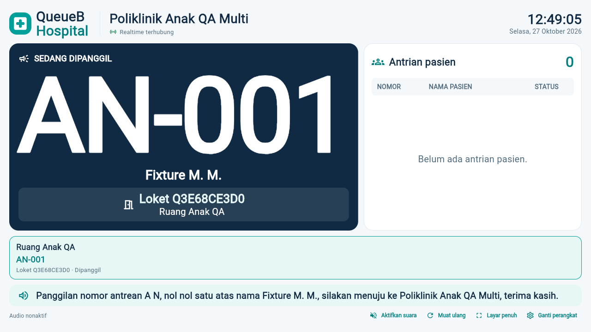

# Public Display — final UI/UX polishing

Tanggal QA: 27 Oktober 2026. Perubahan terbatas pada Flutter Public Display dan harness pengujiannya. Tidak ada perubahan backend, Queue Engine, autentikasi, database, migration, atau portal role lain.

## Tampilan

- Acuan visual tetap token QueueB existing (`QueueBStyle` di `mobile_ui.dart`): navy, teal, putih, kontras tinggi, dan radius kartu yang konsisten. Repository belum memuat dokumen spesifikasi terpisah bernama “QueueB UI/UX Design System V1”; tidak ditambahkan tema/palet pengganti.
- Nomor panggilan menjadi informasi terbesar. Angka jam/nomor menggunakan tabular figures; kode loket dan nama ruang dipisahkan agar tujuan lebih jelas. Nama poli tetap pada header, tidak diulang pada hero.
- Nama mengikuti payload snapshot yang telah disaring server. Default server SAMAR; LENGKAP memerlukan DISPLAY_PATIENT_NAME_MODE=LENGKAP dan DISPLAY_FULL_NAMES_APPROVED=true. TANPA_NAMA tidak memuat nama. Tidak ada kontrol frontend untuk menaikkan izin privasi.
- Daftar pasien memakai baris 52px pada 720p/768p dan 68px pada 1080p, nama hingga dua baris, status Menunggu/Dilewati, serta nomor utuh dengan scale-down untuk kode panjang. Kolom nomor diperlebar setelah QA screenshot menemukan pemotongan angka pada 1080p.
- Kartu ruang dan footer dipadatkan untuk memberi ruang pada panggilan. Kontrol perangkat tetap terlihat, berukuran lebih tenang dan minimum 40px. Empty/loading/reconnect/akses ditolak tetap dibedakan.
- Auto-pagination pasien dan ruang tetap 12 detik, mengikuti snapshot dan membatalkan timer saat disposal. Clock tetap terpisah dari rebuild snapshot. Tidak ditambahkan Scrollable pada layar monitor; viewport sempit tetap preview monitor berskala.

## Perilaku yang dipertahankan

REST snapshot adalah sumber kebenaran, namespace /display hanya menginvalidasi data. CALL/RECALL memakai peristiwaId, dengan baseline senyap pada reload/reconnect. START/COMPLETE tidak menampilkan panggilan lama. Tidak ada perubahan algoritma prioritas.

Pairing tetap cookie HttpOnly per perangkat, SameSite=Strict, Secure pada production dan host-only; UUID nonrahasia di sessionStorage per tab. Scope poli dan validasi credential tetap di server, tanpa fallback cookie antarperangkat. Penolakan akses menghapus snapshot serta menghentikan audio/socket/polling. Gunakan tab baru biasa dan perangkat/kode berbeda, bukan Duplicate Tab, untuk monitor independen.

TTS id-ID existing tetap opsional dan memerlukan klik Aktifkan suara. Kegagalan voice memakai pengumuman visual. Pembatalan ucapan sebelum CALL/RECALL baru dan deduplikasi existing dipertahankan. Baseline tidak mempunyai chime; tidak ditambah layanan suara berbayar.

## Validasi

Hasil final dan screenshot browser disimpan di `public-display-polish-qa.json` dan `images/public-display-polish/` setelah pemeriksaan source final.

- Flutter analyze tanpa issue; format file berubah lulus.
- Seluruh Flutter: 430 PASS, 1 live fixture opsional SKIP. Jumlah lokal mencakup satu tes Dashboard Dokter milik pengguna yang tidak dimasukkan commit ini.
- Web release berhasil. Peringatan WASM dry-run dependency TTS/Socket.IO existing tetap ada; tidak mengklaim build WASM.
- Backend E2E Display snapshot/realtime/pairing: 26/26 PASS dengan privasi SAMAR khusus proses QA. Percobaan pertama 24 PASS/2 gagal karena mewarisi konfigurasi development LENGKAP; pengulangan dengan konfigurasi default lulus tanpa perubahan source/backend/.env.
- Database E2E hanya `127.0.0.1:5433/capstone_antrean_test`; 13 record baseline identik, nol hilang/berubah/fixture tersisa.
- Chrome release + Playwright memakai API NestJS dan Socket.IO nyata pada port QA 3003/5175, empat monitor, dua profil sementara. API define hanya dialihkan oleh server QA saat menyajikan JS; artefak di disk tidak diubah. Tidak menyentuh server localhost:5173 atau data development.
- Skenario: Anak/Bedah bersamaan, tiga monitor Anak konsisten, selector/cookie independen, 401/403 penolakan yang disengaja, CALL/RECALL, SKIP/REQUEUE tanpa duplikasi, reload/socket reconnect, rotasi/nonaktifkan A tidak mengganggu B/C/D, fullscreen, voice id-ID tidak tersedia, auto-pagination 14 pasien.
- Layout 1280×720, 1366×768, 1920×1080 tidak menggulir dokumen; tes widget memeriksa overflow, status kosong/loading/reconnect/rejected, TANPA_NAMA, tombol, kode nomor panjang dan disposal. Preview 320/375/414/768 masih tercakup tes existing.
- TTS browser menggunakan Web Speech test double untuk dispatch, deduplikasi dan pembatalan; tidak mengklaim speaker TV fisik. Request ERR_ABORTED akibat lifecycle dicatat terpisah dari kegagalan HTTP; bukan klaim respons sukses.

## Reproduksi

Dari `apps/client`:

```powershell
flutter analyze
dart format --output=none --set-exit-if-changed lib/src/display_board.dart test/display_polish_test.dart test/display_v3_test.dart
flutter test
flutter build web --release --dart-define=API_BASE_URL=http://localhost:3000/api/v1 --dart-define=SERVICE_TIME_ZONE=Asia/Jakarta
```

Regresi backend memakai runner `apps/api/test/run-admin-delete.cjs` dengan tiga suite display, display-realtime dan display-pairing setelah menetapkan DISPLAY_PATIENT_NAME_MODE=SAMAR serta DISPLAY_FULL_NAMES_APPROVED=false hanya pada proses QA. Jangan arahkan E2E ke development/production.

Runner `apps/client/tool/browser-display-multi-monitor.cjs` mempertahankan kontrak fixture sebelumnya; opsi `engineRoot` menyajikan CanvasKit SDK lokal, `finalPolish:true` menambahkan fullscreen/voice fallback/panggilan tiga resolusi/pagination. Harness test menyediakan `fixture.addWaiting()` untuk membuat 13 tiket MENUNGGU tambahan **hanya** pada poli fixture test dan harus membersihkannya saat selesai. Tidak masukkan kredensial/profil Chrome ke Git.

Untuk pemasangan: jalankan backend dan Flutter dari versi yang sama; refresh/hot restart server Flutter debug yang sudah berjalan sebelum memeriksa hasil baru. Setelah pairing tiap TV, aktifkan audio bila dibutuhkan dan pilih Layar penuh. Verifikasi ketersediaan voice id-ID serta volume speaker pada TV fisik.

## File

- `apps/client/lib/src/display_board.dart`: layout dan tipografi saja.
- `apps/client/test/display_polish_test.dart`: 18 kasus signage/privasi/kontrol/nomor panjang.
- `apps/client/test/display_v3_test.dart`: pencarian halaman terakhir tidak mengasumsikan kapasitas baris tetap.
- `apps/client/tool/browser-display-multi-monitor.cjs`: QA Chrome tambahan, bukan runtime aplikasi.
- Dokumentasi, JSON QA dan screenshot sintetis.

Sembilan entri pekerjaan lokal pengguna tetap cocok dengan manifest/hash awal dan tidak dimasukkan commit. Tidak ada branch/PR baru; workflow langsung main sesuai instruksi.

## Screenshot Chrome final (fixture sintetis)



[1366×768](images/public-display-polish/polish-call-1366.png) · [1920×1080](images/public-display-polish/polish-call-1920.png) · [Auto-pagination dan nomor utuh](images/public-display-polish/polish-pagination-1920.png) · [Poli Bedah terisolasi](images/public-display-polish/chrome-bedah-1366.png).

Chrome 156.0.8078.48: 21 skenario PASS. Empat request ERR_ABORTED dicatat saat lifecycle; tidak ada HTTP 5xx, error console, atau 401/403 tak diharapkan. Cleanup browser final: 13 record existing identik, 0 berubah/hilang/fixture tersisa. SHA256 build final ada di JSON QA.
