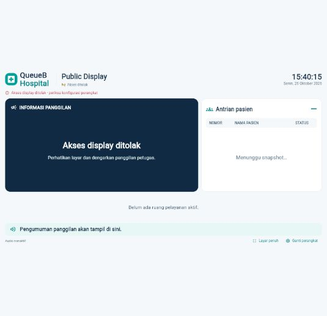
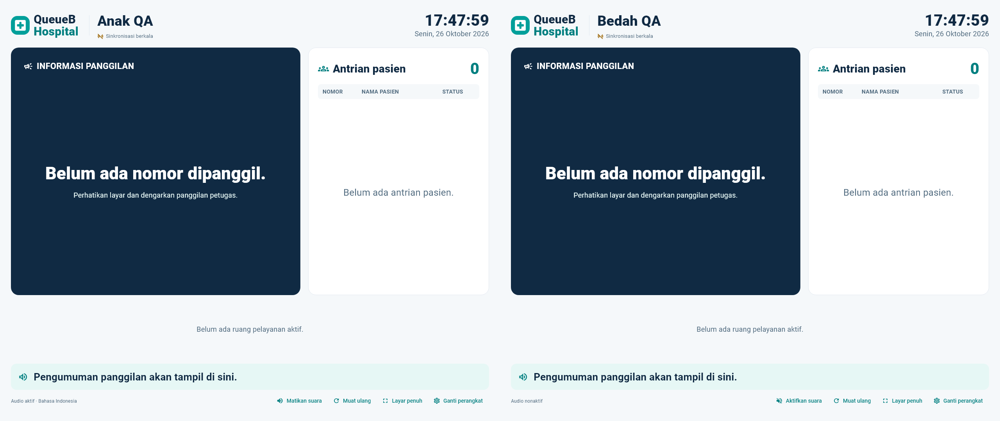

# Public Display — isolasi pairing multi-monitor

## Masalah dan reproduksi

Baseline main setelah PR #70 menulis satu cookie HttpOnly queueb_display, Path=/, untuk semua perangkat pada host yang sama. Cookie mengikuti origin/domain/path, bukan tab. Pairing B menggantikan nilai cookie A. Tab A tetap memegang layananId A dan socket/snapshot berikutnya memakai cookie B: validasi scope yang benar menghasilkan 403 atau UNAUTHORIZED. Akun ADMIN menandai kedua perangkat aktif tidak berarti credential browser keduanya tersimpan.

Reproduksi browser memakai salinan build baseline dan API di 127.0.0.1:5433/capstone_antrean_test. Dua tab dibuka sebelum pairing, lalu dipasangkan ke Anak dan Bedah. Tab Anak menampilkan Akses display ditolak; Bedah tetap Realtime terhubung. Unit/E2E juga mereproduksi HTTP 403 ketika cookie legacy B dipakai untuk snapshot A. Console IAB tidak mencatat error. Akses resource timing/network detail tidak tersedia pada runtime browser ini; status HTTP dibuktikan lewat tes API.

## Perubahan minimum tanpa migration

- Klien Web baru mengirim POST /display/pairing dengan {kode, isolasiSesi:true}. Server menulis queueb_display_<device UUID> sebagai HttpOnly, SameSite=Strict, Secure di production, tanpa Domain. Masa berlaku tetap 30 hari; raw token tidak dikirim dalam JSON/URL/log.
- Hanya UUID perangkat nonrahasia disimpan di sessionStorage per tab dan API_BASE_URL. Tidak ada token jangka panjang di localStorage/sessionStorage atau state Dart. Tab baru tanpa selector menampilkan form pairing, tanpa mengambil sesi tab lain.
- REST sesi, snapshot dan putuskan mengirim x-display-device-id. Socket /display mengirim auth.perangkatId dan auth.layananId; credential tetap cookie HttpOnly otomatis dari browser.
- Server memilih tepat satu cookie berdasarkan UUID tervalidasi, tanpa fallback legacy atau perangkat lain. ID record hasil pencarian hash harus cocok dengan selector; layananId tetap harus sama dengan assignment server. Mengganti clinicId saja ditolak, begitu pula mengganti nama cookie A menjadi B tanpa credential B.
- Reload tab membaca UUID tab itu saja. Reconnect mempertahankan selector dan room. Rotasi/nonaktifkan/forget hanya mengubah record serta socket perangkat sasaran. Satu poli boleh memiliki banyak perangkat dan semuanya menerima invalidasi poli yang sama.
- Legacy pairing tanpa isolasiSesi, header token existing, dan transport native terenkripsi tetap tersedia. Browser build lama tetap memiliki batas cookie tunggal; upgrade Web dan API bersama. Pairing Web lama perlu diulangi sekali pada tab baru karena selector per-tab belum ada; perangkat/data tidak dihapus.

## Lifecycle dan pesan

Belum dipasangkan, kode salah/kedaluwarsa/terpakai, sesi kedaluwarsa/dicabut, perangkat dinonaktifkan, akses scope ditolak dan gangguan server dibedakan melalui form/pesan API. Penolakan mengosongkan snapshot sensitif, menghentikan polling/socket dan audio. Ganti perangkat mencabut hanya cookie yang dipilih sebelum membersihkan selector tab. Kegagalan koneksi tidak dianggap logout perangkat lain. Audio/AnnouncementGate/lifecycle tiap halaman tetap sendiri; bootstrap dan reconnect tidak mengulang TTS lama.

Tidak ada perubahan Queue Engine, prioritas/status antrean, migration, RBAC atau portal role lain. Pagination, pemisahan clock, coalescing snapshot, disposal resource dan aset optimasi tetap dipertahankan.

## Trade-off browser

Tab pada origin yang sama bukan batas keamanan terhadap XSS. Named cookies menghindari penimpaan dan mengikat request pada credential perangkat, tetapi seluruh origin tetap dipercaya oleh browser. Gunakan CSP/origin yang aman; untuk isolasi keamanan antaroperator gunakan profil browser atau origin/perangkat terpisah. Jangan menganggap UUID selector sebagai secret atau menggantikan otorisasi token.

sessionStorage bertahan pada reload, tetapi tab/browser yang ditutup dapat memerlukan pairing ulang. Chrome Duplicate/Open-with-opener dapat menyalin sessionStorage: tab salinan mula-mula mewakili perangkat yang sama, bukan perangkat baru; gunakan tab baru dan kode perangkat berbeda untuk monitor independen. Membuka URL tidak otomatis membuat device atau mengubah poli. Banyak TV fisik sebaiknya memakai browser/profile masing-masing; kuota cookie/header per-origin browser/proxy tetap berlaku.

## Validasi dan batas bukti

Uji otomatis mencakup legacy overwrite; tiga monitor dalam satu cookie jar (Anak, Bedah, Anak); pemalsuan selector/nama cookie; isolasi scope REST/socket; invalidasi CALL/RECALL/SKIP/REQUEUE/START/COMPLETE; reload/reconnect; rotasi A; nonaktifkan A; forget C sementara B tetap aktif. Flutter menguji dua instance halaman, tab baru tanpa ambient credential, reload selector, audio, logout, polling dan disposal yang independen.

Pada checkpoint awal 7380c6e, verifikasi browser sesudah perbaikan masih tertahan oleh URL-confidence alat native. Pada finalisasi berikutnya, Project Lead secara eksplisit meminta Chrome dan Playwright: Google Chrome headless berhasil dijalankan dengan dua profil sementara terpisah, tanpa melampirkan profil pengguna atau melewati interstitial keamanan. Semua URL aplikasi dibatasi ke server QA lokal; hasil browser nyata kini tercatat dalam [laporan final](PR71_FINAL_QA.md) dan [JSON QA](pr71-browser-qa.json). Monitor/speaker TV fisik tetap belum diuji.

Semua fixture browser berada pada database test, dicatat berdasarkan ID unik, lalu dibersihkan. Baseline 13 record identik kembali, tanpa record berubah/hilang atau fixture tersisa. Tidak ada data development yang dihapus atau perangkat existing yang dipasangkan ulang untuk pengujian.

Hasil lokal: unit backend **676/676 PASS** (45 suite); seluruh E2E **383/383 PASS** (31 suite), baseline 13 record identik dan nol fixture tersisa; Flutter seluruh role **354 PASS**, 1 live fixture opsional SKIP. Analyze dan backend lint/typecheck/build lulus. Capture widget dua poli memperlihatkan audio aktif hanya pada monitor kiri; ini memakai mock engine, bukan bukti suara speaker/browser fisik.

Build Web release berhasil; peringatan dry-run WASM berasal dari flutter_tts/socket_io_common existing (tidak mengklaim build WASM). Pengulangan E2E pairing final **11/11 PASS**, termasuk cookie/selector palsu pada Socket.IO; baseline 13 record tetap identik. Format/analyze dan tes multi-monitor final 2/2 PASS. Tidak ada browser QA sesudah perbaikan yang diklaim dari capture widget.

## Finalisasi browser PR #71

Seluruh acceptance criteria Chrome kini PASS. Snapshot sempat menghasilkan Prisma P2028 dengan durasi 7,2 detik saat beberapa Chrome aktif; transaksi baca RepeatableRead memakai batas default 5 detik. Hanya timeout eksekusi snapshot dinaikkan menjadi 15 detik, dengan max-wait existing tetap dan di bawah batas request klien 20 detik. Ini tidak mengubah isolasi, otorisasi, Queue Engine, schema atau data. Unit mengunci opsi tersebut; pengujian browser akhir tidak menghasilkan HTTP 5xx, 401/403 yang tidak diharapkan, atau error console aplikasi.
