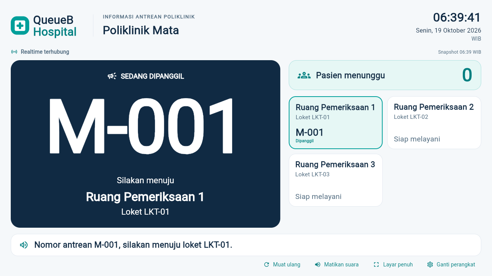

# Public Display V2 — satu layar untuk satu poliklinik

Flutter existing di `apps/client`, namespace Socket.IO `/display`, kontrak [Public Display dan TTS](../backend/API_INTEGRATION_GUIDE.md#5-rest-public-display). Tidak ada perubahan backend, database, Queue Engine, atau role.

## Tampilan dan data

- Kanvas landscape 16:9, diskalakan proporsional pada 1280×720 dan 1920×1080. Preview portrait memakai scroll yang terbaca.
- Branding QueueB, nama poliklinik, jam/tanggal/zona pelayanan dari `SERVICE_TIME_ZONE`, indikator realtime dan waktu snapshot terakhir.
- Nomor **DIPANGGIL** dominan beserta nama ruang dan kode loket. Pengumuman CALL/RECALL memilih pasangan nomor/loket yang cocok; fallback memakai waktu CALL tersimpan terbaru. Tiket DILAYANI tetap terlihat pada kartu ruang, tidak dianggap panggilan baru. COMPLETE menghilangkan nomor sesuai snapshot.
- Kartu semua loket dari snapshot poliklinik yang sama. Bila melebihi tinggi layar, baris berganti otomatis setiap 12 detik; tidak membutuhkan mouse pada TV.
- Jumlah MENUNGGU persis `totalMenunggu`; nol ditampilkan nol, data belum tersedia ditandai `—`. Tidak ada nama pasien, QR, ID tiket, nomor/estimasi buatan.
- Loading, antrean kosong, koneksi terputus, data terakhir belum sinkron, dan token ditolak dibedakan. Token ditolak menghapus data layar dan menghentikan polling/reconnect sampai konfigurasi diperbaiki.

## Realtime dan pengumuman

1. Daftarkan listener sebelum connect dengan `auth: {token, layananId}`. Tidak ada `display:join`.
2. Tunggu `display:ready` yang cocok versi/layanan, lalu GET `/api/v1/display/:layananId/snapshot` dengan header `x-display-token`.
3. Setiap `display:updated` meminta snapshot ulang. Fetch diserialkan dan digabung dengan dirty flag agar event yang tiba saat fetch tidak hilang. Respons sebelum pergantian koneksi tidak menimpa koneksi baru.
4. Polling REST 15 detik menjadi fallback. Koneksi display mencoba pulih dengan backoff Socket.IO selama token tidak ditolak; kebijakan reconnect PETUGAS tetap existing.
5. Suara hanya menggunakan `pengumumanTerakhir.teks` dari snapshot setelah sinyal CALL/RECALL, dengan deduplikasi **peristiwaId**, bukan eventId. Riwayat 256 ID berada di memori; tidak menyimpan token.
6. Bootstrap, muat ulang manual, resume dan reconnect membentuk baseline senyap. Pengumuman yang terlewat ketika offline tidak diputar ulang. Reload browser meminta konfigurasi perangkat lagi dan snapshot pertama tetap senyap.
7. Pengumuman baru membatalkan suara sebelumnya supaya tidak menumpuk. Mute/putus/keluar halaman membatalkan pekerjaan suara; hasil async yang sudah kedaluwarsa tidak mengaktifkan suara kembali.
8. Klik **Aktifkan suara** untuk membuka audio browser dan memeriksa suara `id-ID`. Bila tidak tersedia atau mesin gagal, pengumuman visual tetap berfungsi dan audio ditandai nonaktif. Ketersediaan/pelafalan suara TV tetap perlu diperiksa pada perangkat tujuan.

## Menjalankan demo/TV

1. Jalankan backend existing. Pastikan URL API, origin frontend yang diizinkan, serta `SERVICE_TIME_ZONE` klien cocok dengan konfigurasi backend.
2. Build dari `apps/client`, contoh lingkungan lokal:

   ```powershell
   flutter build web --release --no-web-resources-cdn --no-wasm-dry-run --dart-define=API_BASE_URL=http://localhost:3000/api/v1 --dart-define=SERVICE_TIME_ZONE=Asia/Jakarta
   ```

3. Sajikan `build/web` melalui server Web pada origin yang diizinkan backend. Gunakan alamat API yang dapat dijangkau TV; `localhost` merujuk perangkat yang menjalankan browser tersebut.
4. Dari login pilih **Buka Public Display**. Isi UUID layanan dan token perangkat sah dari pengelola. Token hanya dikirim melalui header REST/auth Socket.IO dan disimpan dalam memori koneksi; tidak ditempatkan pada URL, log atau penyimpanan browser. Input token dibersihkan setelah connect.
5. Aktifkan suara, periksa volume/voice Indonesia, lalu klik **Layar penuh**. Keluar melalui tombol atau Escape. Jika Fullscreen API tidak didukung/ditolak, gunakan fullscreen/kiosk browser/OS. Android memakai immersive UI sesuai dukungan OS; ini bukan penguncian device-owner.
6. USER/PETUGAS tetap memakai aplikasi existing pada perangkat terpisah. Jalankan QR CHECK_IN → ENQUEUE → CALL → RECALL → START → COMPLETE. Nomor, ruang, total dan pengumuman harus mengikuti snapshot tanpa refresh manual.
7. Putuskan jaringan TV lalu pulihkan. Data terakhir ditandai, reconnect membaca ulang snapshot, dan pengumuman lama tidak diulang. **Ganti perangkat** kembali ke konfigurasi dan menghentikan feed/suara.

## QA yang dapat diulang

Tes widget/unit: `flutter analyze`, `flutter test`. Termasuk satu/beberapa loket, kosong, CALL/RECALL, START/COMPLETE, loading, kegagalan token/suara, deduplikasi dan resolusi TV.

QA browser nyata, dari `apps/client`:

```powershell
flutter build web --release --no-web-resources-cdn --no-wasm-dry-run --dart-define=API_BASE_URL=http://127.0.0.1:3001/api/v1
node tool/run-live.cjs --display-v2
```

Runner existing memvalidasi **127.0.0.1:5433/capstone_antrean_test**, memakai fixture unik dan hanya membersihkan fixture run tersebut. Tidak menjalankan migration/reset/seed. Jangan jalankan penulis database test lain secara bersamaan. Setelah QA, build kembali dengan URL API demo sebenarnya.

Screenshot dan hasil browser disimpan lokal di `apps/client/build/web/display-v2-qa/`. QA TTS memakai Web Speech test double terkontrol untuk memastikan dispatch/deduplikasi/fallback secara deterministik; ini bukan bukti suara benar-benar terdengar dari speaker fisik. REST, Socket.IO dan Queue Engine tetap nyata. Pemutusan koneksi hanya menutup transport display fixture milik run tersebut.

## Hasil aktual — 19 Oktober 2026

- Flutter analyze: tidak ada issue. Seluruh tes Flutter: **140 PASS**, satu tes live opsional SKIP; termasuk 19 tes baru Public Display V2. Regresi ADMIN, DOKTER, PETUGAS dan USER lulus.
- Build Web release untuk API test: PASS. Binding Fullscreen API browser juga terkompilasi.
- [QA browser nyata](public-display-v2-web-qa.json): Chromium 156.0.8078.4, satu/tiga ruang, nol menunggu, CALL/RECALL, START/COMPLETE, putus/pulih, bootstrap/reload/reconnect senyap, token salah, suara id-ID tersedia/tidak tersedia secara terkontrol, fullscreen masuk/keluar, serta pemeriksaan privasi semuanya PASS.
- Dua handshake ready, enam frame update dan 12 pembacaan snapshot tercatat. Semua REST display adalah GET ke snapshot publik dengan token di header. Tidak ada token pada URL atau Web Storage.
- Database test: **13 record existing, 0 hilang, 0 berubah, 0 fixture tersisa**. Database development/production tidak disentuh oleh pekerjaan V2.
- Enam ruang diuji di kedua resolusi TV pada tes widget; 12 ruang diuji berganti otomatis. Preview 320/375/414/768 px juga lolos tanpa overflow.
- Run awal Edge tertahan saat startup; QA final memakai Chromium bawaan Playwright. Dua assertion harness diperbaiki untuk semantics gabungan Flutter dan observasi callback/frame sejak sebelum handshake. Tidak ada perubahan backend untuk membuat QA lulus.
- Speaker/voice Indonesia pada TV fisik dan penguncian kiosk OS belum diuji pada perangkat tujuan. Pemeriksaan audio fisik tetap menjadi langkah pemasangan, terpisah dari pembuktian dispatch/deduplikasi TTS.



[Render 1920×1080](images/public-display-v2-1080p.png) · [Antrean kosong](images/public-display-v2-empty.png)
