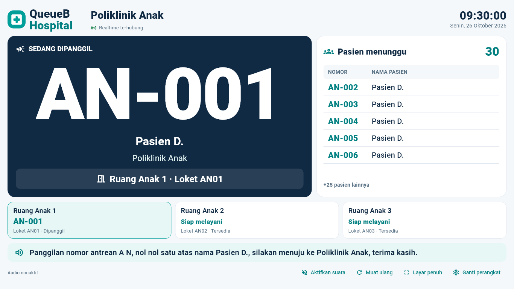
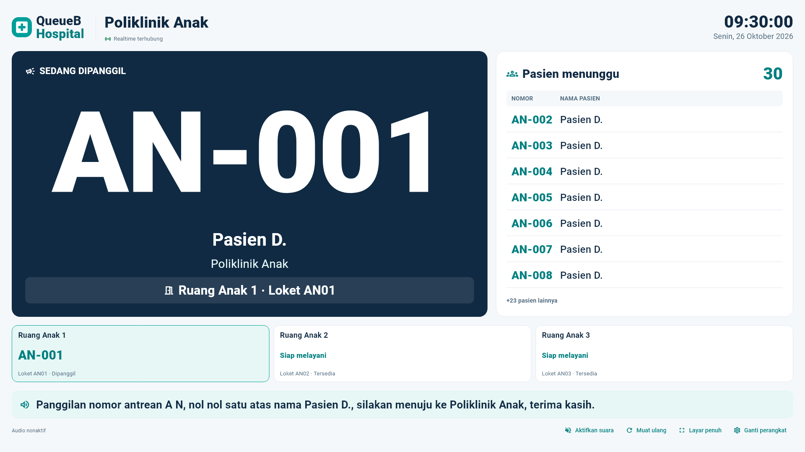
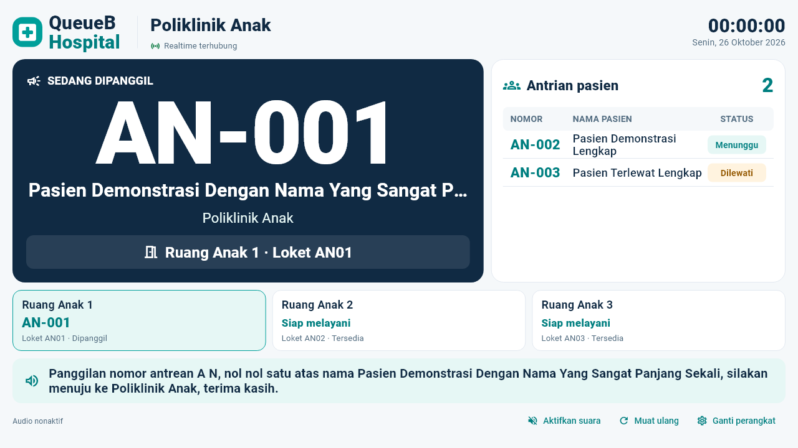

# Public Display Monitor V3

Satu monitor untuk satu poliklinik. Baseline `ba44b38` mencakup PR #67; aset WebP, tema cached, pemisahan clock dari snapshot, dan pelepasan resource TTS tetap dipertahankan. Tidak ada perubahan pairing, autentikasi, Queue Engine, database atau migration.

## Tampilan

- Header branding QueueB, poliklinik, tanggal/jam dan koneksi.
- Panggilan aktif menjadi fokus: nomor besar, nama sesuai kebijakan server, poliklinik dan ruang/loket.
- Daftar menunggu mengikuti urutan snapshot, total sebenarnya, kapasitas baris adaptif dan indikator sisa. Tidak ada permukaan scroll.
- Ringkasan ruang memakai strip kartu; jika terlalu banyak, berpindah halaman otomatis setiap 12 detik. Tidak ada timer rebuild jika hanya satu halaman.
- Footer pengumuman, status audio, aktivasi suara, fullscreen, refresh dan ganti perangkat tetap tersedia. Loading, data kosong, reconnect dan akses ditolak dibedakan.
- Monitor 1280×720, 1366×768 dan 1920×1080 memakai tinggi/lebar viewport. Lebar di bawah 900 atau tinggi di bawah 500 menjadi pratinjau monitor 16:9 berskala, bukan layout ponsel untuk penggunaan TV.

## Privasi dan TTS

Detail kontrak dan konfigurasi berada di [Bagian 25 panduan API](../backend/API_INTEGRATION_GUIDE.md#25-public-display-monitor-v3-v16). Nama lengkap hanya diberikan oleh server dengan dua konfigurasi eksplisit; default disamarkan, tersedia juga tanpa nama. Browser tidak memiliki sakelar untuk membuka nama lengkap. Tidak ada field identitas/medis tambahan atau token pada URL/log.

Teks layar identik dengan TTS: `Panggilan nomor antrean A, nol nol dua atas nama Yusran A., silakan menuju ke Poliklinik Anak, terima kasih.` Nomor tiket tetap A-002 pada kartu. Tidak ada chime pada baseline; TTS platform existing dipertahankan. Suara memerlukan interaksi pengguna dan engine id-ID. Jika tidak tersedia, pengumuman visual tetap berfungsi. CALL/RECALL memakai `peristiwaId`; reconnect, refresh, render ulang dan tick jam tidak memutar ulang ucapan.

## Validasi

Hasil lokal 26 Oktober 2026:

| Pemeriksaan | Hasil |
|---|---|
| Backend unit | 669 PASS, 44 suite |
| E2E snapshot/socket/pairing | 22 PASS |
| E2E selector/hibrida/snapshot/broadcast/QR/booking/reservasi | 126 PASS |
| Flutter seluruh role | 347 PASS, 1 live fixture opsional SKIP |
| Flutter analyze dan format | PASS, tanpa issue/perubahan format |
| Backend lint, type check, NestJS build | PASS |
| Flutter Web release | PASS |

Baseline database test pada kedua kelompok E2E: 13 record awal, 0 berubah/hilang, 0 fixture tersisa. Build Web JavaScript berhasil; dry-run WASM tetap memperingatkan interop pada dependency flutter_tts/socket_io_common existing. Tidak mengklaim dukungan build WASM baru.

 Fixture gambar/test adalah **data sintetis QA**, bukan pasien sebenarnya. Gambar dirender langsung oleh Flutter menggunakan font Roboto dan MaterialIcons; bukan hasil generatif.

- Tes layout: nol/satu/30 menunggu di ketiga resolusi, nama panjang, no Scrollable/no overflow, status START/COMPLETE dan room paging.
- Regresi pairing/token dicabut, audio tidak tersedia/error, deduplikasi CALL/RECALL dan reconnect.
- E2E memakai `127.0.0.1:5433/capstone_antrean_test`, baseline 13 record; hanya fixture unik milik tes yang dibersihkan. Tidak ada koneksi DB development untuk penulisan.
- Pembatalan DIPESAN existing tidak memengaruhi daftar MENUNGGU. Tidak ditambah aturan bisnis pembatalan baru.

### Reproduksi

```powershell
cd apps/client
flutter analyze
dart format --output=none --set-exit-if-changed .
flutter test
flutter build web --release
# Screenshot opsional dari fixture widget:
$env:QUEUEB_CAPTURE_DIR='<folder output absolut>'
$env:QUEUEB_FONT_DIR='<Flutter SDK>/bin/cache/artifacts/material_fonts'
flutter test test/display_v3_test.dart
```

Unit backend: `npm test -- --runInBand`, lint `npm run lint`, type check `npx tsc --noEmit`, build `npm run build`. E2E Display/snapshot/pairing serta selector/QR/booking memakai runner `test/run-admin-delete.cjs` setelah target database test divalidasi. Jangan menunjuk runner E2E ke development/production.

### Sebelum


### Sesudah (fixture QA)





## Pemasangan dan batas verifikasi

Deploy backend dan Web dari commit yang sama agar nama/list tersedia. Setelah pairing, klik Aktifkan Suara lalu Layar Penuh; fullscreen mengikuti dukungan browser/platform. Jangan menggunakan query token. Konfigurasi nama server adalah keputusan fasilitas, tidak diaktifkan otomatis pada development/production oleh PR ini.

Pengujian otomatis audio memakai engine/mock platform: tersedianya suara id-ID dan bunyi dari speaker TV fisik tetap harus dicek saat pemasangan. Socket.IO tetap best effort dengan REST polling 15 detik; multi-instance memerlukan infrastruktur distribusi existing yang sesuai. Tidak ada klaim uji speaker atau monitor fisik.


## Revisi Antrian pasien — 26 Oktober 2026

Panel kanan kini memakai judul **Antrian pasien** dan kolom **Status** (Menunggu teal, Dilewati amber). Angka total mencakup keduanya. Nama mengikuti snapshot server; mode LENGKAP yang sudah ada dipakai untuk development sesuai permintaan operator. Tidak ada perubahan Queue Engine, pairing, schema/migration maupun prioritas panggilan.

Field antrianPasien memuat MENUNGGU lalu DILEWATI pada poli/hari yang sama. Setelah REQUEUE, tiket berpindah kembali ke Menunggu tanpa duplikasi. Status selesai/dibatalkan tidak ditampung. Daftar panjang berganti halaman otomatis setiap 12 detik; timer dibersihkan saat widget dilepas. Nama panjang dapat membungkus hingga dua baris. Backend/frontend harus diperbarui bersama untuk melihat status Dilewati.


### Validasi revisi Antrian pasien

- Unit backend: 675 PASS (45 suite); unit Display final 15 PASS setelah koreksi tipe mock.
- Flutter seluruh role: 352 PASS, 1 live fixture opsional SKIP. Source final Display: 20 PASS dengan capture/layout 1280x720, 1366x768, 1920x1080, nama lengkap, SKIP/REQUEUE dan paging.
- Flutter analyze, backend lint/typecheck, NestJS build dan Web release: PASS.
- Run E2E awal seluruh backend: 378 PASS/3 gagal setup pada hospital-integrasi (timeout dan setup 409 saat beban pengujian bersamaan). Dua fixture unik suite dibersihkan dengan ID/kode terverifikasi, 13 record awal tetap identik. Pengulangan tujuh suite relevan secara terisolasi: **70/70 PASS**, termasuk semua kasus yang gagal. Integritas akhir: existing=13, missing=0, changed=0, remaining=0. Tidak mengklaim satu run seluruh E2E hijau.
- Preview lokal Web :5173 memakai backend preview :3001; backend existing :3000 tidak dihentikan. Konfigurasi API_BASE_URL hanya build-define preview. API health dan Web HTTP 200. Tidak ada penulisan data development oleh smoke test.
- Screenshot fixture sintetis tersedia di tmp/display-status-capture/display-patients-1280.png; tidak memuat pasien sebenarnya. Test dapat direproduksi dengan QUEUEB_CAPTURE_DIR dan QUEUEB_FONT_DIR seperti instruksi sebelumnya.
- Seluruh 28 file lokal pengguna cocok dengan SHA256 preflight. Dua konfigurasi nama development di .env dibackup privat ke tmp/private-display-config; tidak dimasukkan Git. Branch kerja codex/display-patient-status. Finalisasi Git/PR dilakukan setelah QA; tidak ada auto-merge.

### Pengamanan deployment

Default production tetap **SAMAR**. Nama lengkap hanya diberikan jika operator server secara eksplisit mengatur **keduanya**, DISPLAY_PATIENT_NAME_MODE=LENGKAP dan DISPLAY_FULL_NAMES_APPROVED=true. Konfigurasi development bukan perubahan default source, tidak dimasukkan commit, dan tidak boleh disalin ke production tanpa izin fasilitas. Filter token/perangkat, poliklinik dan tanggal tetap wajib.



Checkpoint finalisasi Git: pengulangan kedua tujuh suite E2E kembali **70/70 PASS**; tiga kasus hospital-integrasi yang sempat gagal setup semuanya PASS. Baseline test tetap 13 record, tidak berubah/hilang dan tidak ada fixture tersisa.

## Final polishing — 27 Oktober 2026

Nomor panggilan dan tujuan loket diperjelas, daftar pasien memakai tipografi serta lebar nomor yang lebih terbaca, kartu ruang dan kontrol footer dirapikan. Lihat [laporan final UI/UX](PUBLIC_DISPLAY_FINAL_POLISH.md) untuk hasil QA tiga resolusi, empat monitor, privasi dan batas uji TTS. Pairing, REST/Socket.IO, Queue Engine dan database tidak berubah.
