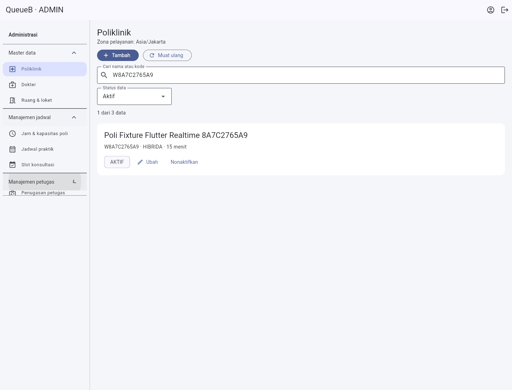
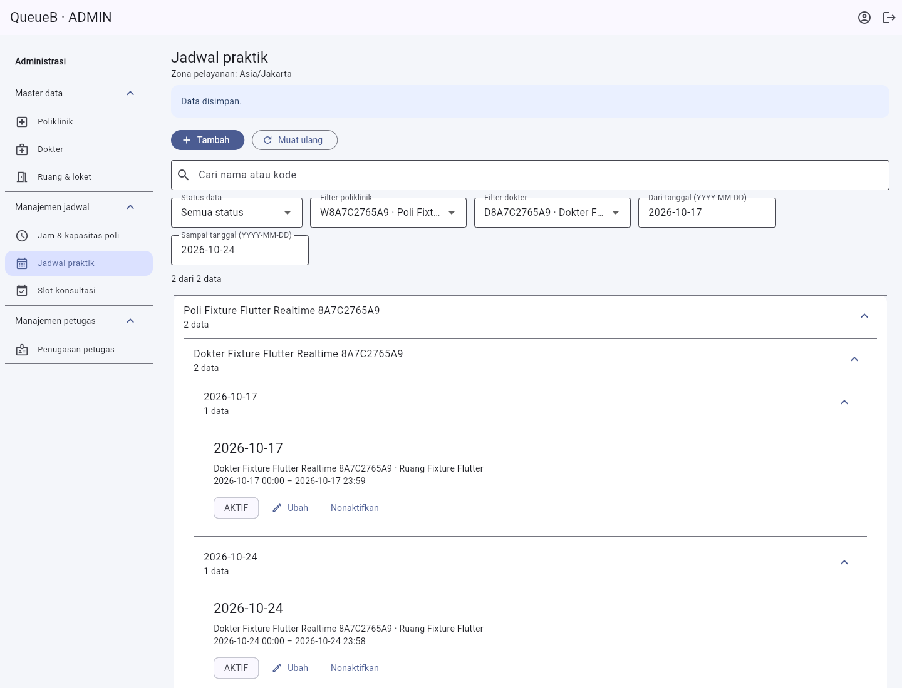
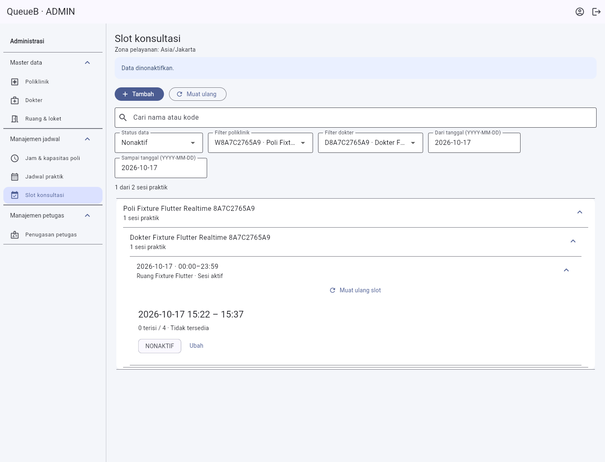

# Realtime pasien dan pengelolaan ADMIN

Tanggal verifikasi: 17 Oktober 2026. Flutter existing `apps/client`, API NestJS existing. Tidak ada migration, perubahan state machine/prioritas antrean, endpoint REST tambahan, desain ulang pasien, atau perubahan Public Display.

## Penyebab dan penyelesaian

Sebelumnya USER tidak memiliki kanal realtime tersendiri. Halaman pasien membaca katalog/daftar saat load atau refresh manual; dialog tiket melakukan polling sepuluh detik. Socket operasional hanya berwenang untuk ADMIN/PETUGAS, sedangkan socket display menggunakan token perangkat dan tidak boleh dipakai sebagai pengganti otorisasi pasien.

Backend kini menyediakan `/patient` dengan access JWT USER dan pemeriksaan sesi aktif. Server menentukan pemilik dari JWT; tidak menerima join room atau ID pengguna/tiket dari klien. Event hanya memuat versi, ID event, jenis invalidasi dan timestamp, tanpa data pribadi. Kandidat sesi diperiksa ulang secara batch sebelum emit; sesi tidak sah diputus. JWT kedaluwarsa memutus socket agar klien menyegarkan token.

Interceptor HTTP menerbitkan invalidasi setelah service/transaksi existing berhasil selesai: reservasi/appointment/pembatalan, CHECK_IN dan seluruh aksi Queue, serta mutasi katalog ADMIN. Rollback tidak mengirim event. Kegagalan notifikasi tidak mengulang mutasi atau membatalkan commit. Respons REST dan audit/transaksi existing dipertahankan. Kontrak lengkap: [API_INTEGRATION_GUIDE.md §6.4](../backend/API_INTEGRATION_GUIDE.md#64-kanal-pasien-patient).

Flutter memakai satu socket USER per halaman, dibagi dengan dialog tiket. Event memicu REST milik sendiri untuk daftar, detail, appointment dan katalog/seleksi jadwal-slot. Tidak menerapkan status langsung dari event. Dedup 256 ID, debounce 250 ms dan fetch terserialisasi dengan pembacaan susulan mencegah respons lama menimpa data baru. Tidak ada listener socket kedua di dialog. Rotasi token membuat koneksi baru dan membuang callback socket lama. Background menghentikan pembacaan otomatis; resume/reconnect menyinkronkan REST. Fallback foreground 30 detik saat putus dan rekonsiliasi dua menit saat tersambung menangani notifikasi yang terlewat.

## Navigasi dan modul ADMIN

Tema Material 3 existing dipertahankan. Desktop memakai sidebar 252 px dengan tiga kategori expandable; layar di bawah 960 px menggunakan menu bottom sheet. Semua tujuan adalah tujuh modul existing:

| Kategori | Modul dan perilaku |
| --- | --- |
| Master data | Poliklinik: pencarian nama/kode, status, kartu ringkas. Dokter: nama/spesialisasi, filter poli, relasi, CRUD existing. Ruang & loket: kelompok poli, lokasi, pencarian/status. |
| Manajemen jadwal | Jam & kapasitas poli: grouped mingguan dan bulk existing dipertahankan. Jadwal praktik: poli → dokter → tanggal, rentang tanggal/status. Slot: poli → dokter → sesi, fetch slot hanya setelah sesi dibuka, status/kapasitas/ketersediaan dan aksi existing. |
| Manajemen petugas | Penugasan per poli, nama petugas/loket, periode dan status, pencarian/filter. Validasi konflik tetap backend. |

Kelompok tertutup tidak membangun isi; baris dipaginasi lokal 20 per halaman. Ini **bukan pagination server**: API existing masih mengembalikan array penuh untuk master data/praktik. Navigasi mengambil modul terpilih, katalog referensi di-cache, dan CRUD/muat ulang memperbarui referensi. Belum ada klaim benchmark produksi atau jaminan memori tak terbatas.

## Pengujian yang dapat diulang

```powershell
# apps/api
node node_modules/typescript/bin/tsc --noEmit
npm run lint
npm test -- --runInBand
npm run build

# apps/client
dart format --output=none --set-exit-if-changed .
flutter analyze
flutter test --reporter expanded
flutter build web --release --no-web-resources-cdn --no-wasm-dry-run --dart-define=API_BASE_URL=http://127.0.0.1:3001/api/v1

# root, setelah build API dan Web QA
node apps/api/test/run-realtime.cjs
node apps/client/tool/run-live.cjs --realtime-admin
node apps/client/tool/run-live.cjs --admin-schedules
```

Harness memaksa dan memvalidasi `127.0.0.1:5433/capstone_antrean_test`, mengoverride provider Prisma agar `.env` tidak dapat mengarahkan query ke development. Sebelum browser dibuka, JS hasil build harus memuat API test `http://127.0.0.1:3001/api/v1`; build development ditolak. Tidak menjalankan migration/reset. Hanya fixture ID/kode unik milik run yang dibersihkan; fingerprint data sebelum/sesudah harus sama. Kredensial/QR hanya di memori run, bukan laporan/Git.

QA lintas klien menggunakan dua instance Edge terpisah yang menjalankan Flutter Web release: PETUGAS desktop dan USER viewport mobile 390 px. Aksi petugas melalui UI/API nyata; USER harus menerima frame `patient:updated`/`patient:ready`, respons GET detail baru dan badge sesuai tanpa tombol refresh, dalam 15 detik (sebelum fallback 30 detik). RECALL wajib menghasilkan pembacaan baru walaupun status tetap DIPANGGIL. Putus jaringan menutup transport WebSocket native di harness karena mode offline Chromium saja bisa mempertahankan socket existing. Freeze/resume memakai lifecycle tab Chromium; tes widget juga memeriksa lifecycle Flutter. Ini **bukan** bukti Android fisik/Doze atau push background.

Booking/pembatalan appointment dikirim dari sesi HTTP USER pemilik saat klien Flutter USER yang sama terbuka, sehingga pembaruan tidak berasal dari callback tombol booking. USER lain memeriksa REST tiket asing (404) dan tidak menerima event TIKET. Perubahan poli/dokter oleh ADMIN dibaca ulang di layar pendaftaran pasien.

## Hasil aktual

| Pemeriksaan | Hasil aktual |
| --- | --- |
| Unit backend | **583/583 PASS**, 36 suite; mencakup 13 kasus interceptor invalidasi baru |
| E2E realtime backend | **18/18 PASS**, empat suite: USER, room PETUGAS, Public Display dan Origin; suite USER memakai transport Socket.IO nyata dengan double JWT/sesi eksplisit |
| Type check / lint / NestJS build | **PASS** |
| Flutter unit/widget | **74 PASS**; satu tes live umum SKIP secara default (pengujian live browser dijalankan terpisah) |
| Dart format / Flutter analyze | **PASS**, 23 file tanpa perubahan format, analyzer tanpa temuan |
| Web release JS/CanvasKit | **PASS**, build QA API 3001 dan build development API localhost:3000 |
| Android APK debug | **PASS**, `apps/client/build/app/outputs/flutter-apk/app-debug.apk`, API USB `127.0.0.1:3000`; perangkat fisik tidak diuji ulang pada task ini |
| Guard target browser QA | **PASS**, build development ditolak sebelum browser/API dibuka |
| Dua klien Flutter + NestJS/PostgreSQL nyata | **PASS**, 11 pemeriksaan status/tindakan, dua invalidasi katalog, isolasi, reconnect dan freeze/resume |
| ADMIN browser | **PASS**, enam modul yang berubah: pencarian/filter/grouping dan CRUD; konflik sesi berslot tetap HTTP 409 |
| Regresi jam & kapasitas poli | **PASS**, bulk lima hari, existing aktif/nonaktif dilewati, kegagalan parsial 503 terkontrol, edit/nonaktifkan, login ulang konsisten; delapan POST jadwal total, tanpa runtime error |
| Dataset besar/responsif | **PASS** pada tes widget sintetis 11 poli, 22 dokter, 440 sesi dan viewport 320/375/414/768/1440 |
| Proteksi database test | **13 record existing identik**, tidak ada fixture tersisa setelah setiap run; tanpa migration/reset |

Run gabungan final memakai dua instance Edge independen. CHECK_IN, ENQUEUE, CALL, RECALL, CALL sesudah REQUEUE, START, COMPLETE dan pembatalan appointment menyelesaikan pengamatan UI+REST dalam **491–2.482 ms**; CALL awal **779 ms**. Ini pengukuran QA lokal termasuk aksi UI, bukan SLA jaringan/perangkat. SKIP diamati setelah offline/reconnect, REQUEUE setelah freeze/resume, dan DIPESAN muncul dari booking eksternal tanpa refresh manual. Rincian tersanitasi: [realtime-admin-qa.json](realtime-admin-qa.json).





Bukti tambahan: [kelompok ruang](images/admin-room-groups.png), [kelompok penugasan](images/admin-assignment-groups.png), [pasien otomatis DIPANGGIL](images/patient-realtime-call.png), [pasien otomatis SELESAI](images/patient-realtime-complete.png), [hasil regresi bulk](admin-bulk-regression-qa.json). Semua screenshot menggunakan fixture sintetis; QR/token tidak disimpan di screenshot ini.

## Batas dan tindak lanjut

- Event best effort tanpa replay/outbox. Reconnect/resume/fallback REST wajib dipertahankan. Distribusi invalidasi lintas instance NestJS belum disediakan; perlu adapter/bus bila deployment diperbanyak.
- Kanal baru dipicu mutasi HTTP yang dikenal. Pemanggilan service internal/job di luar HTTP perlu invalidasi eksplisit bila kelak ditambahkan.
- Status pembatalan/slot kedaluwarsa tetap mengikuti kontrak backend existing. Tidak menambahkan aturan toleransi/fairness atau resolusi manual HOSP-OPS-01.
- APK debug perlu API_BASE_URL yang sesuai perangkat, misalnya USB reverse `http://127.0.0.1:3000/api/v1`. Tidak menyimpan token di dart-define. Build debug bukan pengujian perangkat fisik atau release produksi.
- Dataset regresi widget sintetis: 11 poli, 22 dokter, 440 sesi. Membuktikan lazy rendering/filter/responsiveness, bukan benchmark jaringan/database produksi.
- Build Android mencatat peringatan native access JDK dan penggunaan Kotlin Gradle Plugin oleh `flutter_tts`; build tetap berhasil. Runner API mencatat peringatan deprecation query bersamaan dari `pg`. Tidak melakukan upgrade dependency di luar scope ini.

## File utama

| Area | Berkas |
| --- | --- |
| Backend | `apps/api/src/realtime/patient-realtime.gateway.ts`, `patient-invalidation.interceptor.ts`, `patient-invalidation.interceptor.spec.ts`, `realtime.module.ts`; `apps/api/src/config/socket-handshake-security.ts` |
| E2E backend | `apps/api/test/patient-realtime.e2e-spec.ts`, `socket-origin.e2e-spec.ts`, `run-realtime.cjs` |
| Flutter | `apps/client/lib/src/patient_sync.dart`, `patient.dart`, `admin_navigation.dart`, `admin_data.dart`, `admin.dart` |
| Tes Flutter | `apps/client/test/patient_sync_test.dart`, `admin_optimization_test.dart` |
| Tooling | `apps/client/tool/browser-realtime-admin.cjs`, `browser-demo.cjs`, `browser-smoke.cjs`, `browser-admin-schedules.cjs`, `run-live.cjs` |
| Dokumentasi/bukti | Panduan API v1.3, README client, laporan ini, dua JSON QA dan tujuh screenshot fixture |

Semua source tetap pada aplikasi existing. File lokal React/Vite, backup, `.env`, schema review dan perubahan root di luar scope tidak disertakan.

Catatan desain: identitas warna/font mengikuti tema Flutter existing; judul memakai nama API, bukan UUID. Tidak menambahkan angka demonstratif ke UI produksi, aset, dekorasi, atau menu tanpa fungsi. Pemeriksaan akhir dilakukan pada screenshot browser dan tes viewport 320/375/414/768/1440. Aturan CSS/marketing yang tidak berlaku pada Flutter tidak diklaim lulus.
